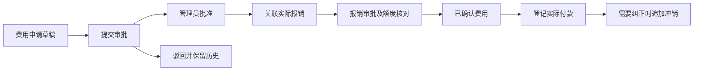

# 财务费用、订单成本与站内风险提醒

日期：2026-10-27。范围：在现有 workspace、双库和三个角色基础上增加本地可验证的一期功能。用户已选 DeepSeek 与站内通知。本文件是实施契约与测试环境变更审核材料，不代表云端已应用本轮迁移或已启用模型。

## 一、财务管理的业务范围

| 模块 | 本期处理 | 边界 |
| --- | --- | --- |
| 业务收付款 | 保留已有销售应收、采购应付、登记与确认 | 不发起真实银行转账 |
| 费用申请 | 员工建立草稿、提交、管理员批准／驳回、取消 | 事前预算授权，不计已确认成本 |
| 费用报销 | 原始凭证编号、申请关联、额度控制、批准、付款登记、冲销 | 已批准报销计入已确认成本；已付款另计现金成本 |
| 订单成本分析 | 首版报价预算、后续预计版本、已确认采购与报销、已付款成本 | 是业务贡献利润估算，不是会计净利润或总账结账 |
| 业务风险中心 | 规则预警、按订单归属推送、已读记录、DeepSeek辅助分析 | 站内轮询；不自动审批、付款、改价或发站外消息 |
| 退税、签章、我方资料 | 沿用已有模块 | 本轮不改正式单据生成逻辑 |

暂未实现：员工借款与备用金、拆分／合并付款、会计凭证与总账、税额核算、公共费用自动分摊、报销单独立电子附件、发票真实性查验、外部财务系统自动记账。原始凭证当前以编号关联线下／已有资料；不能宣称已完成电子票据归档。

## 二、角色与状态流程

- 沿用 admin、sales、operations；没有悄悄增加财务角色或扩大原订单字段读取权限。
- 每个员工只能查看本人费用，管理员查看公司全部；关联订单必须有相应写入／履约权限。
- 批准、驳回、付款登记及冲销由管理员执行，并沿用 MFA；不能审批自己的申请。单管理员部署中，管理员本人报销需增加另一位真实管理员后才能审批，不自动豁免。
- 完整成本利润仅管理员可见。销售与运营接收本人负责订单的脱敏风险，不接收供应商成本、银行信息或利润金额。共享只读订单不自动获得风险分发资格。

报销也可不关联事前申请直接提交。关联时要求同申请人、同公司、同订单、同币种、同费用类别且原申请已批准；已提交、已批准和已付款的关联报销占用申请额度。并发核对依赖已有公司行锁和事务，不使用进程内锁。相同凭证不能重复提交有效报销；相同付款凭证不能在多个有效付款记录中重复使用。本期不支持一张发票拆为多份报销或一笔银行付款对应多份报销。

请求幂等沿用 requestId＋载荷摘要；状态变更要求 expectedVersion。草稿字段本期不覆盖修改，需要更正时取消后重建；历史单、审计与冲销痕迹保留。

## 三、成本与利润口径

八类：采购、生产追加、物流运输、报关港杂、保险、银行手续费、佣金、其他。采购价已包含的生产成本不再次填入“生产追加”；该栏仅表示额外加价。

1. 首版成本计划固定为报价基线，记录订单来源版本、收入、费用、折算汇率和报价有效期；后续只追加版本。
2. 最新预计由管理员维护全量预计成本，已确认采购与批准报销自动归集为已确认承诺。
3. 每类最终预计成本取“人工预计”与“已确认承诺”的较大者，两者不直接相加，以免重复计费。已确认采购／报销金额发生变化时，原预计口径先失效，暂停确定利润，要求管理员重新确认每类全部预计成本；否则新增附加费可能被原预算掩盖。保存时同时校验数据指纹，防止按旧页面提交。
4. 预计利润＝当前订单收入－各类预计成本；利润变化与固定报价基线比较。
5. 已确认承诺＝已确认采购单全额＋已批准／已付款报销。费用申请、待审批报销不当作已确认费用；待审批报销另提示复核。
6. 已付款成本＝有效采购付款＋已登记付款报销，单独展示；不能再加到预计成本中。
7. 金额使用最小单位整数和 BigInt；汇率最多6位小数，按源／目标币种精度折算并四舍五入。无自动实时汇率。
8. 缺成本、缺汇率时不显示确定利润；原始基线含未知成本时也不显示确定基线利润或利润差。暂估成本可显示“预计”，同时提示未锁价。
9. 更换订单币种导致与基线不一致时停止利润判断，提示人工核对；不能把原币种数字直接当新币种。

例：收入100 USD，报价采购50、物流10，预算利润40；运费改为60，预计成本110，预计利润为-10。已确认采购50只作为采购类下限，不再与人工预计采购50相加。

本期没有自动扣税、自动加入退税、摊销公共管理费或计提坏账，因此界面不能标为会计净利润。

## 四、业务流程风险地图

| 节点 | 常见风险与应留数据 | 本期自动能力 | 需要后续数据或人工确认 |
| --- | --- | --- | --- |
| 客户询盘／报价 | 漏算费用、成本未锁定、报价失效、币种错配 | 无基线、缺项、暂估、报价到期、低利润率 | 客户信用、付款条件结构化、报价市场竞争性 |
| 接单／合同 | 数量、条款、交期变化后成本没重算 | 订单来源版本与成本版本不一致 | 合同条款审核、付款与费用承担条款逐项检查 |
| 采购 | 原采购价上涨、未取得有效供应商确认 | 已确认采购归集及超预算 | 尚未录入的供应商报价变化无法自动感知 |
| 生产 | 原料、加工、加班、返工、交期延误 | 生产追加成本超预算、交付逾期 | 生产进度／质检数据、涨价原因及责任认定 |
| 订舱／物流 | 临时涨运价、附加费、滞港滞箱 | 物流超预算、有物流预计费用时的报价过期 | 实时报价、船期、港口事件、费用承担 |
| 出口／单据 | 单证不一致、归类或资料缺失 | 沿用已有单据、CO和退税资料校验 | 不声称已实现报关合规、制裁筛查或税法判断 |
| 收款／结汇 | 逾期、汇率偏离、手续费侵蚀利润 | 逾期未收款、成本折算汇率与基线变化 | 银行真实结汇、信用证审单和跨币种核销 |
| 费用／结案 | 重复报销、超申请、费用未归集 | 凭证重复、申请额度、待审批报销、预计亏损 | 实际会计成本、公共费用分摊和最终结账 |

贸易术语、指定地点和合同约定影响双方费用与风险承担；本期不根据一个 FOB／CIF 标签直接推断所有费用为零或自动决定责任。应由经办人确认，模型仅提供复核建议。[ICC Incoterms 2020](https://iccwbo.org/business-solutions/incoterms-rules/incoterms-2020/)

## 五、站内通知

- `/workspace/risks` 按公司、销售负责人和运营负责人查询；管理员看公司范围。
- 每页核对20个订单，支持翻页；页面打开时约60秒刷新，顶栏约90秒查询。顶栏提示来自当前查询页，不冒充全部订单未读总数。
- 风险已读按员工独立记录，标已读不等于解决。相关业务状态、成本版本或金额变化会改变指纹，生成新的未读提示。
- 这是轮询站内提醒，不是 WebSocket 实时推送、后台Cron或邮件／企微通知。浏览器关闭时不自动外发；重新打开后按最新数据计算。
- 生产涨价、外部运价等未录入的数据，规则与模型都不能凭空发现。

## 六、DeepSeek接入与费用边界

模型调用通过服务端固定的 `https://api.deepseek.com/chat/completions`，禁止跟随重定向，不允许用户指定外部URL，无新增依赖。

请求仅包括规则代码、阶段、标题和通用建议。没有客户姓名、订单金额、供应商价格、银行账户、员工资料、原始单据或自由文本合同。DeepSeek解释规则已发现的风险，提出人工核对建议；不重新计算金额，不调用业务写工具。

返回JSON经Zod验证，建议必须引用本次输入中的风险编号；限制响应、输入与输出大小。UI按纯文本显示，不把AI返回当HTML执行。使用非思考模式、有界输出，避免无界推理消耗。[JSON Output](https://api-docs.deepseek.com/guides/json_mode/) · [Chat Completions](https://api-docs.deepseek.com/api/create-chat-completion/)

服务端环境变量已写入示例和本地Compose：

| 变量 | 默认与用途 |
| --- | --- |
| DEEPSEEK_RISK_ENABLED | false；关闭时不发请求 |
| DEEPSEEK_API_KEY | 空；仅服务端安全配置，禁止发到聊天或知识库 |
| DEEPSEEK_MODEL | 空；按当前官方文档核对可用模型后配置 |
| DEEPSEEK_DAILY_BUDGET_USD_MICROS | 0；公司每日美元微单位上限，1 USD＝1,000,000 |
| DEEPSEEK_DAILY_CALL_LIMIT | 0；公司每日调用数；代码另限制成员每日最多5次 |
| DEEPSEEK_INPUT_USD_MICROS_PER_MILLION | 0；核实后的保守输入单价（每百万token） |
| DEEPSEEK_OUTPUT_USD_MICROS_PER_MILLION | 0；核实后的保守输出单价（每百万token） |
| DEEPSEEK_PRICES_VERIFIED_AT | 空；价格核实日期，超过7天需复核 |

未填密钥、未核价、预算为0或开关关闭时，真实调用都拒绝。2026-10-27官方文档列出的模型名为deepseek-flash和deepseek-v4-pro；代码显式允许这两个名称，未自动替用户启用。启用前再次核对官方清单与峰值单价，不使用测试夹具作为真实价格配置。[Models & Pricing](https://api-docs.deepseek.com/quick_start/pricing/)

每次调用先在公司事务锁内按保守输入16384token、输出1024token预留费用，并登记请求；实际发送前原子认领。同请求ID重试读取原结果，不重新请求模型。所有状态的预留都计入当日额度，失败或结果未知不自动退款，宁可少用也不重复消费。

收到的有界响应在解析模型内容前写入私有回执；保存可用token用量和结果，原始回执不进普通日志。超时、解析失败或保存失败时保留额度，标记或保留运行状态供核对，不自动重试。预留是保守控制值，不是供应商最终账单；价格变化或提供商统计差异仍需人工对账。启用前也应设置供应商侧额度；本轮没有调用真实付费服务。相同订单与经办人存在保留、运行或未知请求时，不允许另起请求绕过核对；管理员可在风险中心记录服务商核对证据，关闭未知或超过30分钟未完成的请求，仍不释放额度。

本地纯局域网模式下，费用、成本与规则照常工作；DeepSeek需要互联网，无网时保留规则提示。

## 七、迁移、兼容与恢复审核

**需人类审核的云端变更材料**：`scripts/sql/finance-expenses-costs.sql`。仅目标业务测试库追加四表：expense_claims、order_cost_plans、risk_reads、risk_ai_runs；身份库不变。使用现有business_backend最小列授权，不向anon/authenticated公开，不授予财务记录DELETE。没有新增套餐、服务或依赖。

已共享的旧SQL不改。本文件及本轮SQL在云端应用前可按验证结果整理；一旦应用，后续只能追加迁移。本轮暂未应用云端。

云端启用顺序：核对备份与目标库 → 审核追加SQL并应用 → 保持AI关闭发布候选 → 使用虚构资料验证三角色及费用全流程 → 切换测试站 → 独立安全配置DeepSeek密钥、模型与核价预算 → 按批准硬上限小样验证。未授权真实用户数据外发。

恢复方式：应用回退至上一已验证部署，保留新增表、财务历史和审计；必要时关闭模型开关。数据库恢复属于独立恢复任务，不能直接删新表当回滚。旧应用不认识新模块，但不覆盖新记录。

## 八、验证范围

新增测试覆盖金额换算、JPY精度、报价与采购物流差异、不重复叠加、缺项拒绝确定利润、费用私有范围、自己不可审批、申请额度占用、陈旧版本、幂等、付款冲销、成本快照保留、脱敏站内风险、已读隔离、AI固定端点、证据编号校验、额度预留、重放和未知结果不重试。

最终本地回归：73个测试文件、249项通过；构建与类型检查通过；lint仅两项原有警告。见 `docs/evidence/2026-10-27-finance-expenses-risk.md`。

本地集成采用PGlite与私有角色权限；UI采用隔离虚构接口数据。它们不等于云端三角色完整验收、真实模型内容质量评估或实际客户财务验收。实际命令及结果另记入本轮evidence。
