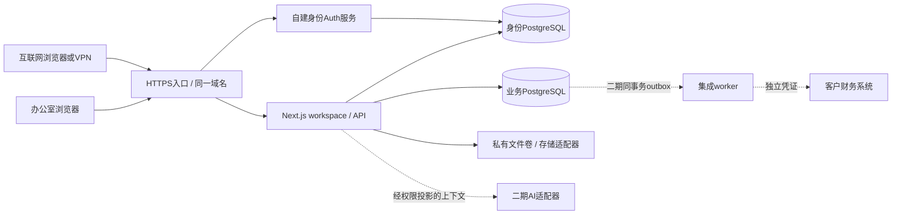

# 思链台本地化与二期扩展方案

## 结论与假设

建议将思链台做成“一套模块化单体、每客户一个独立实例、同一数据源提供内网和互联网访问”的交付产品。先完成首个客户的安装、升级、备份和财务对接闭环，再考虑共享多租户SaaS。保留现有云验收站做比较基线。

这是可评审候选方案，不是已定案合同。用户目前没有服务器，也没有给出财务系统品牌/API或AI预算；不购买硬件、不安装系统、不迁移真实云数据、不增加外部费用。当前补充代码只验证可配置部署、存储接口、CI及接口契约。

待验证假设：首批客户是小型外贸团队，允许办公室常开服务器；愿意指定运维负责人；需要多人共享且对公网访问有需求。若客户没有运维人员，托管实例可能更合适。

## 1. 三条路线

| 路线 | 客户收益 | 主要代价 | 当前判断 |
|---|---|---|---|
| 每客户本地独立实例 | 数据留在客户处，办公室业务不依赖海外服务 | 硬件、备份、更新、DNS/TLS需要维护 | 推荐作为第一交付形态 |
| 每客户国内托管实例 | 远程使用和集中运维方便 | 持续云资源成本、资质与数据责任需明确 | 复用同一容器，作为可选交付 |
| 共享多租户SaaS | 批量开通、统一更新 | 隔离、租户成员模型、计费、运维和事故面更复杂 | 暂缓，不能把company_id直接当作SaaS已完成 |

还可选择Tailscale等VPN访问本地实例，减少公网入口维护，但不等于无需客户端的公共网页。具体服务套餐及成本在选型时核验，不在此承诺免费。

## 2. 最先统一的产品边界

- 唯一业务界面 `/workspace`；管理员页面保留，旧demo重定向，不迁移旧localStorage。
- 业务台账与会计系统分工：思链台管理贸易履约及应收应付，对方财务系统负责凭证、科目、期间和记账。
- 每客户实例使用独立身份数据库、独立业务数据库、独立私有文件卷与密钥。首批不跨客户共用账号库。
- “本地部署”“办公室断公网可用”“浏览器完全离线”是三种承诺。本期目标是前两种；浏览器仍需连到办公室服务器，不开发客户端离线副本。

## 3. 推荐拓扑

模块化单体保留，worker在需要可靠异步任务时独立进程运行，不为了AI或“模块化”先引入微服务/Kubernetes/消息中间件。

## 4. 身份方案的关键取舍

A：自建Supabase Auth，保留现有MFA/SSR、成员管理和会话撤权；优点是业务鉴权改动小，代价是官方自建栈运维组件较多。B：换成本地专用身份服务/重新实现账号；表面更轻，却需重新验证MFA、密码恢复、会话吊销及管理员保护，不适合急于首单时顺便重写。C：继续用海外托管Auth；移植最快，但办公室断公网就不能保证登录，不满足完整本地目标。

候选推荐A，先证明成本与维护可接受。官方支持Docker自建；不把开发用supabase start当生产服务器。正式上线前精简不需要的服务、固定上游版本和镜像digest、检查MFA/TOTP配置及升级说明。当前deploy/local没有自动安装或复制官方栈。

来源：[Supabase自建Docker文档](https://supabase.com/docs/guides/self-hosting/docker)、[Auth配置](https://supabase.com/docs/guides/self-hosting/auth/config)。

## 5. 双网络模式

优先采用同一HTTPS域名和分域DNS：办公室DNS解析到内网地址，公网DNS指向网关；两条线路到同一个实例，所以没有数据同步或冲突。公网接入失败时，内网登录、MFA、上传、PDF依然应在受信任TLS下可用。互联网AI、邮件和财务API则显示不可用/待重试，不阻塞本地订单事务。

局域网候选Caddy内部CA，必须给员工设备安装信任；公网使用可验证证书。不能用普通http局域网IP偷换验收，因为Secure Cookie、Web Crypto和MFA流程依赖安全上下文。固定域名、证书续期和移动设备信任需要实际验证。

若有公网IP，可由客户控制路由/NAT只转发80/443；若无公网IP，比较VPN或受控隧道，明确其外网依赖、访问控制及费用。不暴露DB、Studio、Docker API和文件卷，不把CDN当作数据库性能方案。没有网络条件前不承诺公网可达。

本轮候选Caddy文件是两种独立入口配置，选一种部署；它们不构成双机高可用。互联网证书加分域DNS可实现内外同时访问，同一origin减少Cookie与跨域复杂度。

## 6. 已开始的底座开发

- CI：push/PR跑固定依赖安装、lint、完整测试、build、typecheck及standalone构建；不自动部署客户生产环境。
- 应用：self-hosted模式构建standalone，保留云构建默认值；删除Auth管理固定云URL，服务端可走内部地址，Cookie名称仍按浏览器公共地址，避免内外hostname不同造成登录循环。
- 双库：自建模式明确host/用途角色/标记；私有网络可显式关闭DB TLS，公网或云配置拒绝无验证降级；未修改现有云库。
- 文件：BusinessStorage新增私有磁盘实现，目录边界、拒绝符号链接、原子不可覆盖发布，沿用上传后回读SHA256核验。文件与分片使用不同物理路径，兼容最终归档。
- 财务/AI：提供version=1 schema和TypeScript端口，默认未激活；没有新增外部调用。

这些是为方案提供证据的可逆开发，不表示安装器、迁移、灾备和客户验收已完成。

## 7. 财务接口需要做成什么

先向潜在客户索取系统品牌/版本、API或导入格式、记账主体、币种精度、票据/凭证规则和测试沙箱。第一种集成可以是经确认的CSV导出，第二种再做服务器适配器；不要先承诺能接任意财务软件。

版本化事件包含eventId、companyId、payment/order/purchaseId、业务日、kind、currency、amountMinor整数字符串、版本及冲销关联。二期必须在业务确认/冲销同事务写入outbox；独立worker先查幂等状态再发送，超时进入needs_reconciliation，不能靠无限重试制造重复凭证。

财务反馈区分已接收与已记账；保留externalId，按币种核对金额和冲销。凭证不能被“AI自动判断”直接入账。当前integration_outbox没有给业务运行角色开放，也未写入事件；现有契约不是已接通接口。

## 8. AI二期空间

从低风险收益开始：客户跟进摘要、合同/PDF字段抽取、订单资料缺件提醒；AI返回建议和引用，由用户确认后走既有业务命令。HS归类、报价、付款、签章和报税不自动批准。

端口按任务而非供应商设计，模型可选客户本地服务或经批准的外部服务；上下文必须先通过现有权限投影，带来源ID/版本，不让模型获得原始DB连接、管理密钥或任意SQL。检索按company/用户可读范围进行，不能先全库检索再在UI遮挡。

需要补充：任务表、状态/超时/取消、预算、速率、模型和提示版本、输出schema、文档注入隔离、引用与人工复核、数据外发开关及日志脱敏。初期不急着向量库/RAG/Agent框架；资料量和检索质量证明需要后再引入，明确许可证与升级成本。

本轮代码只有契约和关闭门槛，没有AI按钮、模型下载、token消费或已完成AI功能的承诺。

## 9. 安装与升级才是商业交付的难点

首单必须交付：环境预检、无明文聊天密钥配置、空库初始化、首管理员及TOTP、私有文件权限、备份调度、版本清单、schema迁移checksum、升级前备份、应用回滚、数据恢复演练。新装与升级是不同流程，禁止把全量初始化SQL在已有库重新执行。

云到本地迁移需要一致性窗口；Auth账号/密码hash/MFA/会话与业务company/member UUID和对象引用必须统一迁移或明确重新开通规则。先用虚构副本演练，再单独授权停写/切换；不自动复制当前验收数据给客户。

建议先确定目标RPO≤24小时、RTO≤4小时，由客户确认并用恢复演练校准，不作为未经测试的SLA。数据库、Auth、私有文件和加密密钥要一起恢复；GitHub只备份代码。

## 10. 开发顺序与准入门槛

| 阶段 | 产物 | 进入下一阶段条件 |
|---|---|---|
| D0 当前 | workspace入口、真实文档、CI、私有代码备份、候选架构/适配契约 | 两方案交叉评审，客户场景确认 |
| D1 首次可安装 | 固定容器清单、官方身份栈接线、初始化/迁移工具、首管理员引导 | 全新机器按手册成功安装，不靠开发者临场修SQL |
| D2 本地闭环 | 三角色、采购到货出运、单据、CO、文件与收付款 | Docker重启和断公网后仍能完整执行业务；实际并发不超量 |
| D3 双入口与灾备 | 分域DNS/TLS、公网或VPN、备份恢复、更新回退 | 内外同一订单一致；另一台机器恢复并校验文件摘要 |
| D4 首个财务适配 | 事件outbox、对账、沙箱适配器 | 重放/超时/冲销不重复入账，财务确认 |
| D5 AI试点 | 单任务、授权检索、引用、人工确认 | 数据权限、错误输出、注入、预算测试通过 |

工期先按里程碑管理，拿到服务器与财务沙箱后再估算；不因有潜在客户就把尚未运行的Compose称为可交付产品。

## 11. 与用户方案交换时的评审问题

1. 客户更看重数据留本地，还是少操心运维？谁负责断电、硬盘损坏和员工手机换机？
2. “互联网两套模式”是否只要外出访问同一实例？是否真的要求两套独立服务器同步？后者需另立同步协议与冲突规则。
3. 初始角色和审批是所有客户通用，还是需要每客户工作流配置？首单先固定哪条流程？
4. 财务系统有稳定API吗？客户接受按日文件导入，还是需要实时回执？
5. 哪些资料允许外发给AI？客户是否要求完全本地模型，愿意承担什么硬件和维护成本？
6. 交付买断、维护订阅或托管服务如何分工？更新窗口、模板定制、数据可导出与退场交接是否明确？

评审采用“保留／否决／待实验”三列，按可验证事实去伪存真。优先做一台新机器安装演练、一次断公网闭环、一次异机恢复及一个财务事件重放实验，胜过先写宏大的平台蓝图。

## 2026-10-25交叉评审补充

已收到用户双版本/ports方案。后续取舍参考同目录《思链台双版本方案交叉评审与合并建议》：保留共用业务核心；身份提供者先做自建Supabase与Better Auth对比；不推荐首版自写认证或默认新增MinIO；Mac AI分开验证；补财务、双网络承诺与可恢复备份。本文仍是候选方案，未自动更换基础设施。
