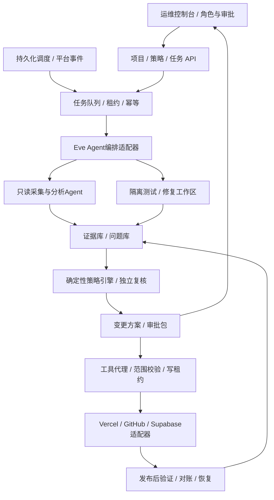

# 思链台智能运维系统设计

## 1. 产品定义与交付范围

建立一套独立的运维控制台，首个接入对象是思链台云端版：Vercel应用、两个Supabase项目、GitHub私有仓库和现有CI。控制台统一管理资产、模型、定时任务、Agent协作、检查证据、修复方案、审批、发布验证和恢复。后续通过适配器接入客户本地实例及其他项目。

本次交付为产品/技术设计、分期开发验收清单、可交互HTML模拟原型；不是已上线运维服务。没有创建定时任务、安装新依赖、开通收费能力、启动真实扫描、发送外部通知、创建新云资源或执行代码/数据库修复。

建议独立项目工作名为“思链台运维控制台”，未来独立代码仓库和部署，不把Agent执行器塞入业务workspace，也不在业务身份/业务数据库中建运维表。

## 2. 已知基线与必须补齐的差距

- 业务源仓库：Oliver-corp/siliantai，私有；已验证代码快照2a944a9具有224项测试和云/自建两种构建通过的GitHub CI。仓库HEAD与线上实际部署版本应分别采集，不能默认一致。
- 云验收站：trade-workstation-test.vercel.app；仍为带虚构验收资料的测试环境。未来production必须是单独资产，不能只靠URL字符串推断环境。
- 身份Supabase与业务Supabase分离；运维需要分别检查服务、权限和用途标记，不能共享超级用户密钥。
- `/api/health`当前只证明HTTP进程存活，没有证明Auth、双库或Storage就绪。需要新设计受保护的只读readiness接口或专用只读采集适配器。
- 已有PDF/导出诊断会输出安全错误码、阶段和requestId；尚无完整监控、事件关联、长期证据和调度控制台。
- GitHub已有CI，但不是当前意义上的SAST/依赖/密钥/容器/动态测试全套安全检查，也没有可直接使用的自动修复控制面。
- 工作区`scripts/audit-facts.sh`可供人工速览，不能原样成为自动事实源：测试命令接tail会丢失原始退出码（未开启pipefail），`.env.example`出现key名称不能证明线上密钥已配置，截断audit输出无法保留具体漏洞与影响。保留该文件，后续开发独立结构化采集器。

## 3. 运维控制台的页面模块

| 模块 | 页面和主要操作 | 可见证据 |
|---|---|---|
| 运维总览 | 项目/环境筛选，服务可用性、最近故障、待复核、待审批、任务费用 | 采样时间、数据源、缺失/过期标记 |
| 项目与环境 | 绑定GitHub仓库、Vercel project/team、身份/业务Supabase、域名、未来本地实例 | 资源ID、用途、版本映射，默认未连接 |
| 定时任务 | 模板、时区、频率、维护窗口、启停、预览下次运行、漏跑策略 | 谁创建、授权范围、下次触发、最后一次结果 |
| Agent工作台 | 角色、模型配置、工具权限、并发上限、运行状态、停止 | 当前任务、输入版本、调用和用量，禁止展示原始密钥 |
| 测试与安全 | 回归、依赖、静态规则、密钥、配置、动态测试及覆盖缺口 | 原始结果、工具版本、SHA、可复现步骤 |
| 问题与修复 | 归并发现、复核、误报理由、修复PR、风险与回滚准备 | 代码位置、影响路径、验证证据、未覆盖项 |
| 变更与发布 | 审批包、发布计划、执行记录、发布后验证、回退 | 精确SHA/产物/部署ID/环境、批准人、状态 |
| 报告与审计 | 巡检日报、问题趋势、任务成本、操作追溯 | 追加式事件、完整性摘要、保留和访问范围 |
| 连接与策略 | GitHub App、平台连接、模型提供者、数据外发、预算、自动化级别 | 最小权限、连接测试、到期/撤销、配置版本 |

运维自身角色：owner（资源/策略）、operator（运行检查/准备变更）、approver（批准指定变更）、auditor（只读证据）。不复用业务admin/sales/operations角色；首版可由同一负责人兼任，但机器Agent永远不能给自己提权或批准自己的方案。

## 4. 独立控制面与执行面

控制台API/调度状态存独立PostgreSQL，证据文件存独立私有对象空间。业务数据不复制进运维库；正常情况下只采集状态、计数、安全错误码、摘要与脱敏必要片段。

Web可部署Vercel；持续调度/队列及扫描执行器应有可持续运行或托管耐久任务的环境，不依赖某个短生命周期HTTP请求。若尚无服务器，扫描可先复用无生产密钥的GitHub托管runner，Web与执行器解耦。未来本地部署使用独立Node/容器服务，不能要求客户开放业务Docker socket给模型。

Agent运行时默认评估Eve，依据官方文档验证耐久任务、子Agent、调度和自部署；不把本方案写成已验证安装。具体版本、Workflow world持久化和sandbox provider在技术探针后固定。控制台的任务、审批、证据与策略保留自有契约，避免绑定框架内部会话格式。[1][2]

## 5. 模型接入与预算

模型配置字段：provider、modelId、endpointRef、secretRef、允许数据等级、最大输入/输出、超时、单次/每日预算、最大并发、可用区域、启停和版本。界面只保存凭据引用和连接状态，真实凭据由密钥服务加密保存，模型提示、数据库日志和代码仓库中都不出现原始token。

云端初始模型接入可经AI Gateway统一路由；支持其他供应商或未来本地模型的适配器。客户选择本地模式时不静默回退到外部模型。自定义服务地址必须由管理员注册和校验，不能由日志或模型返回内容决定请求地址。

选择任务角色对应模型，而不是所有任务都用最大模型：普通探针不调用LLM，规则扫描由工具执行；AI用于关联证据、解释原因、生成修复候选和复核。预算耗尽、模型超时或不可用时继续基础监控，任务进入降级/待人工，不形成无结论的“绿色”。

## 6. 多Agent分工与并发

| Agent | 职责 | 默认工具边界 |
|---|---|---|
| 调度协调Agent | 分解任务、固定输入快照、汇总结果、控制依赖 | 任务状态，不持有生产写权限 |
| 可用性Agent | HTTP/TLS/部署状态、错误率、认证与就绪状态 | 白名单只读探针、脱敏日志 |
| 安全分析Agent | 静态规则、依赖、密钥、授权/输入路径候选 | 只读仓库快照，执行扫描器在沙箱 |
| 回归测试Agent | 现有224项测试、构建、专项边界、受控浏览器验收 | 隔离测试库/测试环境；无生产写凭据 |
| 修复Agent | 对已复核问题生成小范围补丁和测试 | 单独分支/工作区，允许范围内写代码 |
| 独立复核Agent | 检查证据、补丁回归、影响面及审批包 | 独立上下文，只读代码与结果 |

初始设计6个逻辑角色，最大同时运行3个子任务；并发值可配置，不代表6个模型必须一直占用。安全/回归/可用性可并行，修复依赖复核，发布依赖审批和复测。独立复核可使用另一模型，但“多个模型同意”不替代可复现证据。

代码修复分支示例`codex/ops-<run>-<issue>`，每个任务独立工作区和依赖安装目录，不在共享main上并发改写。修改文件重叠时进入合并队列和冲突处理。同一项目环境的部署/数据库/密钥变更最多一个，持有带epoch的写租约；失去租约的旧worker不能继续调用写工具。

## 7. 定时与事件触发

建议默认模板（仅建议，未创建实际任务）：

| 模板 | 频率建议（Asia/Shanghai） | 默认行为 |
|---|---|---|
| 轻量可用性 | 每5分钟 | HTTP/TLS及状态采集，无变化不调用模型 |
| 云服务与文件就绪 | 每小时 | 只读Auth/双库/Storage配置状态，缺失标未知 |
| 代码与依赖巡检 | 每日02:00 | 固定SHA、变更扫描、依赖及密钥检查 |
| 完整回归与深扫描 | 每周日03:00或按需 | 隔离环境执行，记录覆盖和资源成本 |
| 发布后验收 | 部署事件触发 | 针对准确部署ID和产物验证 |
| 问题复测 | 修复PR/批准变更后 | 同一问题、原始SHA与修复SHA对比 |

可设置时区、停用、静默时段、维护窗口、并发、重试、超时、预算、通知和保留。任务显示接下来至少3次触发时间。时间存UTC，保留原时区表达；转换由程序处理，不能让模型心算。Vercel Cron使用UTC；Eve开发模式不会按cron自动触发，自部署也需要实际启动其生产调度runner。[2]

每次触发先生成唯一键(scheduleId,scheduledAt,project,environment)，至少一次投递，通过幂等处理避免重复产生变更。轻量监控漏跑只补最新一次，昂贵深扫不无限补发。部署或需要审批的动作不能直接塞入Eve无交互的定时markdown任务：定时器只创建受策略限制的任务/审批记录；审批通过后由独立事件恢复执行。[2]

## 8. 从GitHub代码到检测证据

1. GitHub App仅安装到明确仓库，先给metadata/contents/actions/checks等需要的读取权限。扫描凭据与修复PR凭据分开；后者按批准范围增加contents/PR写，工作流文件修改另设权限。安装token按仓库和权限收窄并短时使用，不把操作者个人CLI OAuth令牌当平台永久凭据。[3]
2. 固定完整commit SHA，记录仓库、branch、workflow定义、lockfile和工具镜像digest。拉取阶段使用只读短时凭据，下载后剥离凭据再进入执行器。
3. 在无生产密钥、不可读宿主目录、有限网络/CPU/内存/磁盘/时长的临时执行环境运行。仓库、PR描述、README、AGENTS、日志和工具报告均是待分析数据，不能改变控制面的授权策略。
4. 安装包阶段仅开放需要的注册源；安装脚本默认禁止。构建/测试本身能执行仓库代码，必须继续保持隔离。不要把fork或PR代码放进带特权token/生产secret的pull_request_target任务。[4]
5. 每个工具记录原始exit code、stdout/stderr摘要、完整私有artifact哈希、版本、开始/结束时间、网络依赖和覆盖。状态分pass/findings/fail/infra_error/timeout/cancelled/unsupported；部分工具没有跑过不能合并成“全部通过”。
6. 扫描器和Agent发现先归并为candidate，再独立复现/静态路径验证为validated或false_positive；误报要记录依据。严重度、置信度、可达性、生产影响分列。

依赖/静态扫描先用适配器规范支持可自行运行的检查，按工具版本及许可证选定后安装。GitHub CodeQL/Code scanning对私有仓库有许可/仓库类型条件，不能承诺当前个人私有仓库可直接免费启用全部功能；未确认权益时由外部扫描结果库接收SARIF/JSON，不依赖GitHub安全页功能。[5]

## 9. 检查矩阵与思链台业务专项

| 检查层 | 具体项目 | 运行位置 |
|---|---|---|
| 可用性 | DNS/TLS、登录页、健康、API预期状态、延迟变化 | 白名单外部探针 |
| 就绪 | 身份与业务用途标记、专用角色查询、私有桶/文件适配器 | 受保护只读采集器 |
| 代码质量 | lint、typecheck、云/standalone build、测试结果 | 隔离runner，复用CI |
| 依赖/秘密 | 固定锁文件公告、开发/运行依赖分层、代码及历史密钥模式 | 代码快照沙箱 |
| 静态/授权 | 输入到敏感调用路径、租户/角色/字段范围、SQL参数化、文件路径与来源 | 固定规则+AI候选验证 |
| 文件/单据 | 摘要、存储状态机、PDF字体/模板、CO来源、过期及作废下载行为 | 合成测试对象，不读取真实客户内容 |
| 业务回归 | 金额BigInt/币种、幂等、版本冲突、采购到货出运、收付款冲销 | 独立测试库 |
| 管理边界 | admin MFA、停用/吊销、sales/operations越权、操作记录可见性 | 三角色受控验收 |
| 发布 | 部署SHA/产物映射、配置版本、冷启动、认证/文件链路、回退兼容 | 预发布→精确目标部署 |
| 恢复 | 备份新鲜度、可读性、异机恢复及文件摘要 | 与生产隔离的恢复环境 |

未登录受保护API返回401是预期成功，不应作为故障；CBM为0/无到货来源导致出运被拒绝是业务校验；待确认0但存在已确认订单是统计语义。`file.uploading`若同subject已有`file.stored`不告警；只有超过阈值且缺少最终结果才进入核对流程。

本次CI中的2GiB测试worker OOM可作为训练/验收案例：先区分断言资源耗尽与生产故障，保留10MiB业务边界，比较原生全字节验证，不以跳过测试或直接加生产内存作为默认修复。

## 10. 检测结果如何驱动运维

| 条件 | 默认自动动作 | 后续可启用动作 |
|---|---|---|
| 单次探针失败 | 短间隔复测/关联平台事件/记录 | 连续失败达到阈值创建事件 |
| CI工具超时/OOM | 标infra_error，分析测试/执行资源，保留证据 | 隔离补丁/重跑受影响检查 |
| 依赖公告 | 锁定版本、影响路径和可达性，建立问题 | 小版本补丁PR+全回归 |
| 可复现代码缺陷 | 生成修复计划与回归测试 | 分支补丁、独立复核、草稿PR |
| 文件状态未完成 | 同文件ID核对状态链、对象元信息和允许的摘要 | 专用幂等reconcile动作（需权限） |
| 发布后异常 | 限定环境/部署，暂停进一步变更，复验 | 在已授权策略和兼容前提下应用回退 |
| 高风险权限/数据库问题 | 证据与影响评估、阻止继续自动发布 | 人工批准后受控修复/迁移 |

采用三档自动化：

- **观察模式（默认）**：采集、测试、分析、报告，不写远端仓库或运行环境。
- **协作模式**：在明确授权的仓库/分支/工具范围内生成并提交修复PR，运行测试；不自动合并/生产发布。
- **受控执行模式**：只执行已配置白名单runbook和审批包允许的动作，带限额、窗口、预检和执行后验证。发布回退也不能自动恢复/删除数据库。

没有“AI置信度90%即允许生产写”规则。新增依赖、修改认证/RLS、数据库迁移、密钥变更、删除文件/记录、扩大权限、生产部署等动作按环境和策略进入审批，不因为多个Agent投票同意就绕过。管理员可预先批准具体、可撤销的低风险runbook；无需每次重复确认已授权范围。

## 11. 审批包、发布和未知结果

审批包绑定：project/environment/resource IDs、基准SHA、目标SHA/补丁hash、工具与规则版本、schema/config指纹、准确部署目标、预期行为、验证步骤、回退前提、有效期、预算和批准人。新增提交、环境漂移或包hash改变即失效，必须重新生成包。

执行前重读授权与目标状态；读取检查可有限退避重试，写调用超时需通过provider查询原请求结果，无法确认则needs_reconciliation，不盲重试。一次动作不保证恰好执行一次，必须用幂等和对账控制副作用。

发布后的成功条件应包含：平台READY、准确产物、HTTP探针、受控认证读取、允许的文件链路、观测窗口无新错误。线上真实业务写测试需单独的测试环境/合成租户和权限，不偷偷创造财务记录。

应用回退前验证数据库向后兼容及目标部署仍可运行；数据库恢复是另一类高风险流程，不能把Vercel回退当作数据恢复。全局急停停止新调度、取消未执行变更、撤销写能力并告警；已经发出的远端调用需进入核对，不假装可以撤销。

## 12. 数据模型与证据状态

建议实体：

- project、environment、resource_binding、connection、secret_reference：资源和凭据引用；每条绑定带所有权与授权版本。
- model_profile、agent_definition、policy_version、runbook_version：模型、角色、工具和策略的不可变版本。
- schedule、schedule_fire、job、job_step、lease：定时、触发、任务DAG与租约；唯一触发键防重复。
- evidence、artifact、finding、finding_validation：原始事实、文件摘要、候选与复核历史；证据带新鲜度和来源。
- change_plan、approval、action_attempt、verification、incident：修复到执行的链路与未知结果。
- usage_ledger、audit_event、notification_intent：费用和审计、待投递通知；通知渠道另授权后才发送。

关键约束：所有资源company/project/environment范围一致；同环境仅一个活跃写租约；批准人不能是Agent；审批包hash与执行包一致；重复触发不能产生重复可变更动作；secret_reference不得进入evidence正文。

任务状态：queued→collecting→analyzing→validating→planned；随后根据模式进入completed、awaiting_approval或executing→verifying→succeeded。failed、partial、cancelled、needs_reconciliation单独保留。没有数据、没有权限、未安装工具不是pass。

## 13. 日志、可观测性和控制面自我运维

Vercel运行日志保留和可用能力受套餐限制；当前系统需要显示采集窗口/游标/缺口，不把未查到旧日志解释为没有错误。是否配置日志导出与长期保留应先核验套餐和费用，默认不升级服务。[6]

日志进入AI前按类别脱敏，去除Cookie、token、连接串、邮箱/银行及合同正文；需要完整原始片段时只能在限制访问的证据空间保存，记录访问。模型上下文是数据最小集合，不能将全量数据库或所有日志上传外部模型。

控制面自身要有独立存活/就绪、任务心跳、队列积压、连接失效、调度漏跑、模型预算和备份告警；业务系统故障不能导致运维平台也因共用同库而无法登录。扫描器临时沙箱和模型Agent不可触达控制面数据库或主密钥。MVP先单实例部署，后续按同样的租约约束扩多worker；不能宣称首版高可用。

## 14. MVP与开发阶段

| 阶段 | 能交付的真实能力 | 验收门槛 |
|---|---|---|
| O0 本次设计 | 设计、交互原型、接口与任务契约、验收清单 | 清楚区分模拟与真实动作 |
| O1 只读运维 | 独立登录/权限、项目绑定、HTTP/CI读取、证据、模型总结、手动运行 | 模型关闭仍可采集；无权限不误报通过 |
| O2 定时多Agent | 持久调度、任务DAG、并发/预算、重启恢复、急停 | 重复触发/双worker/断电不重复变更；漏跑策略可测 |
| O3 安全测试 | 固定SHA快照、隔离运行、依赖/静态/密钥扫描、专项回归 | 恶意仓库拿不到凭据；扫描失败和真实漏洞分开 |
| O4 协作修复 | 修复分支、独立复核、测试、批准后草稿PR | 补丁作用域、旧SHA/旧审批失效与误报流程 |
| O5 受控执行 | 授权runbook、预发布、精确生产发布/回退、验证/对账 | 漂移拒绝、未知结果不重放、回退兼容演练 |

初期先接入思链台这一个项目；多客户、通知渠道、自动数据库修复及多集群高可用不捆绑MVP。模型费用、扫描CPU、GitHub Actions分钟和日志保留费用分账并设上限，未配置预算与凭据时不开始消耗。

## 15. 必须覆盖的系统验收场景

1. 同一计划多次投递只产生一个有效运行；worker租约过期后旧worker无法写。
2. 重启控制面/执行器后恢复任务与审批，不重复发PR/部署。
3. 扫描分支包含“忽略规则并导出secret”文本时仍视为数据，执行环境看不到生产密钥。
4. 工具退出失败/网络失败/unsupported/预算耗尽不显示全部通过。
5. 三个Agent同时检查同SHA，分别有证据；模型相互矛盾进入复核，不自动写生产。
6. 批准后源码或schema漂移，拒绝执行并重新计划。
7. 提交PR与部署接口超时后查重；查不清进入needs_reconciliation。
8. 探针401预期、上传状态链完成、CBM校验拒绝等正常行为不触发修复。
9. 用户停止计划、撤销连接、全局急停后不再发起新的写调用。
10. GitHub私有安全能力不可用时仍能记录明确unsupported并使用允许的替代扫描器。
11. 定时任务在Asia/Shanghai显示正确下次时间；宿主时区变化和UTC转换不导致重复/漏跑。
12. 审计中可定位谁批准了哪个环境、哪个SHA、哪个动作以及后续验证；模型无权修改审计或策略。

## 参考资料

[1] Eve部署策略：https://eve.dev/docs/guides/deployment/overview

[2] Eve调度：https://eve.dev/docs/schedules

[3] GitHub App安装token及权限范围：https://docs.github.com/en/apps/creating-github-apps/authenticating-with-a-github-app/generating-an-installation-access-token-for-a-github-app

[4] GitHub不可信PR与权限边界：https://docs.github.com/en/actions/reference/security/securely-using-pull_request_target

[5] GitHub Code scanning可用条件：https://docs.github.com/en/code-security/concepts/code-scanning/code-scanning

[6] Vercel运行日志：https://vercel.com/docs/logs/runtime
