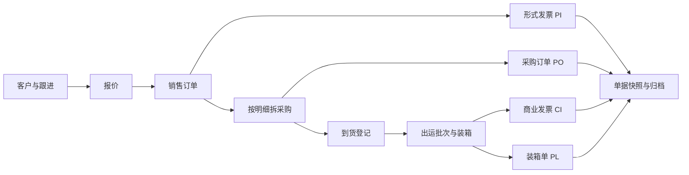
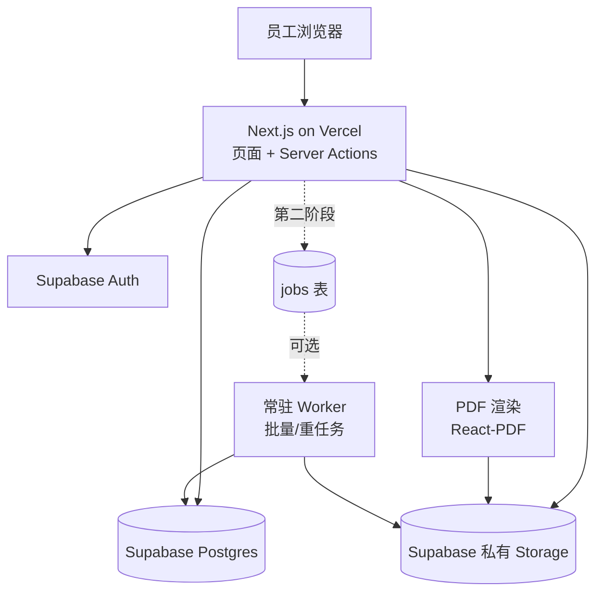
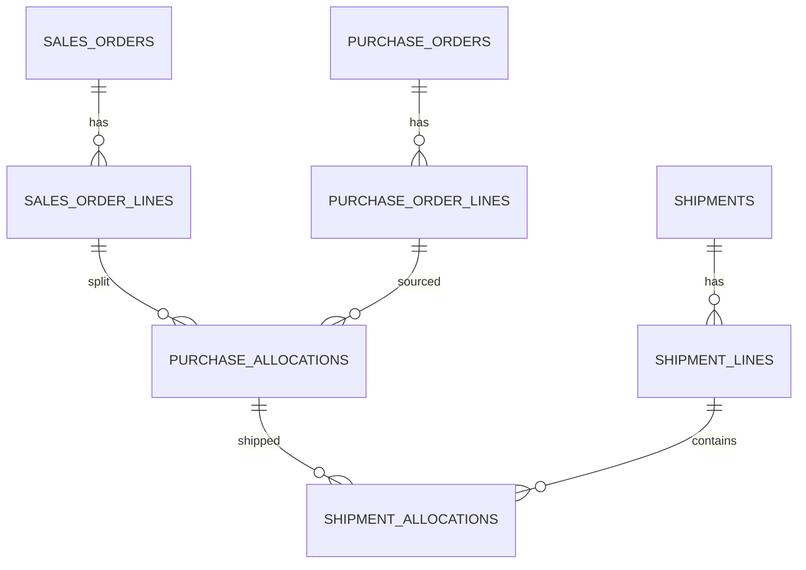

# 外贸工作平台整体开发方案（评审修订版）

版本：v1.0（评审 + 可执行修订）  
日期：2026-10-23  
评审对象：《外贸工作平台整体开发方案》v0.1  
文档性质：方案评审结论 + 修订后的开发基线。本文不表示已完成开发、部署或运行验证。  
适用范围：单公司主体、自营采购出口、接到海外 B2B 客户订单后向国内供应商采购。

---

## 0. 结论摘要

### 0.1 总体判断

v0.1 的产品方向、业务边界和风险意识明显高于普通方案，尤其是“销售 / 采购 / 出运分离”“明细分配”“业务快照”“金额不用浮点”“审核后变更走新版本”这些判断是正确的。

但它更像一份**需求规格与风险清单**，还不是一份可以直接排期开发的工程方案。主要问题不是“方向错”，而是：

1. 第一版范围过大，缺少真正的取舍；
2. PDF 与后台任务没有落到可运行的宿主；
3. 权限到底走 API 还是 RLS 没有定论；
4. 数据模型没有细到可以建表；
5. 没有工期、成本、区域、备份的可执行数字。

按 v0.1 直接开工，最容易出现的结局是：每个模块都做了一点，但没有一条业务链能独立验收。

### 0.2 评分

| 维度 | 评分 | 结论 |
| --- | --- | --- |
| 可落地性 | 3.0 / 5 | 技术方向可行，但 PDF、后台任务、权限落点三处悬空 |
| 易开发性 | 2.5 / 5 | 第一版包含 11 个模块、7 类状态机，缺少纵切和 MVP 取舍 |
| 易维护性 | 3.5 / 5 | 模块化单体、快照、审计原则正确；版本化与双权限路径需要收敛 |
| 可迭代性 | 3.0 / 5 | 分阶段是“能力横切”，不是“业务纵切”，阶段 1 难以独立产生价值 |
| 经济性 | 3.0 / 5 | 云成本可控，但低估了 PDF 渲染、任务编排和人力成本 |
| **综合** | **3.0 / 5** | **可作为需求基线，不能直接作为开发排期依据** |

### 0.3 必须改的五件事

1. **先定 PDF 与任务宿主**：第一版用 React-PDF 同步生成；不在 Vercel 函数里跑 Chromium；批量任务第二阶段再上 worker。
2. **权限只保留一个写入口**：所有业务读写走 Next.js 服务端 + 统一 `authorize()`；RLS 只做纵深防御和存储策略，不做第二套业务权限。
3. **版本化收敛**：主数据“可变 + 审计”，订单“乐观锁 + 变更记录”，只有单据做不可变快照；不要给所有实体建版本表。
4. **MVP 砍成一条纵切**：客户 → 报价 → 销售订单 → 拆采购 → 到货 → 分批出运 → 4～5 张单据 PDF。
5. **给出可执行数字**：区域、备份、月成本、里程碑、验收门槛，不能继续用“待确认”代替决策。

---

## 1. 评审方法与依据

### 1.1 评审角度

- **可落地性**：今天能否买到、部署、跑通；关键能力是否有确定的运行环境。
- **易开发性**：一名熟悉技术栈的工程师能否在合理周期内完成；是否存在不必要的通用化。
- **易维护性**：一年后换人能否接手；规则是否只有一处；升级和迁移是否可控。
- **可迭代性**：第一版能否独立使用；后续加功能是否要推翻模型。
- **经济性**：三年总拥有成本，包括云资源、人力、迁移、停机和对业务的摩擦。

### 1.2 核实过的平台口径

以下数字用于判断可行性，价格和限制以官方页面为准，实施前应再次核对：

| 平台 | 关键限制 | 对本方案的影响 |
| --- | --- | --- |
| Vercel Functions | Hobby 最长 300s；Pro 默认 300s、最大 800s；请求/响应体 4.5MB；Hobby 仅限非商业用途 | 不能把“持久后台任务”默认放在 Vercel；大文件不能经函数中转 |
| Supabase Edge Functions | 256MB 内存、CPU 2s、墙钟 150s/400s | 不适合跑 Chromium，也不适合长任务 |
| Supabase Pro | $25/月起，含 Micro 计算与 7 天备份；Free 项目 1 周无活动会暂停 | 生产必须 Pro；Free 不能作为正式环境 |
| Supabase Storage | Free 单文件 50MB，Pro 500GB；标准上传建议 6MB 以下，大文件用 TUS | 附件直传私有桶，避免走 Vercel 4.5MB 限制 |
| Cloudflare Browser Rendering | Paid 每月含 10 浏览器小时，超出 $0.09/小时 | 可作为 HTML→PDF 的低成本备选，但会引入第三个平台 |
| Vercel Pro | $20/开发者/月；应用使用者不需要 Vercel 席位 | 5 名员工使用不等于 5 个 Vercel 席位 |

参考链接见文末。

---

## 2. 逐项审核

### 2.1 可落地性：3.0 / 5

#### 做得好的地方

- 选择 Vercel + Supabase，对 3～10 人的团队是合理起点，运维负担低。
- 明确“一个仓库、一个网页应用、模块化 API”，没有早期拆微服务。
- 明确私有存储、短时链接、服务端密钥边界，安全意识正确。
- 明确“生成的辅助表格不能冒充正式凭证”，这是外贸系统必须守住的边界。

#### 阻塞落地的问题

**问题 1：PDF 与后台任务没有宿主。**

v0.1 第 6.1 节画了“持久化任务与渲染执行器”，第 6.3 节写“具体产品在技术验证后确定”，第 8.2 节要求任务可恢复、可租约接管。这些要求本身没错，但没有任何一处说明它跑在哪里。

Vercel Functions 是无状态短时执行环境，Pro 最长 800s，且不适合常驻 Chromium；Supabase Edge Functions 只有 2s CPU、256MB 内存。把“持久任务 + 浏览器渲染”放在这两个平台上，等于把最难的运维问题留到开发中途。

**修订建议：**

- 第一版不做异步队列。单张单据在请求内同步生成，目标 10 秒内完成。
- 渲染优先用 `@react-pdf/renderer`：无浏览器、冷启动可控、部署简单；中文字体打包 Noto Sans SC 子集。
- 如果 2 天技术验证证明 React-PDF 无法满足复杂表格/分页/盖章位置，再改用 Cloudflare Browser Rendering 的 HTML→PDF Quick Action，或一台 $5/月 的 VPS 跑 Playwright worker。
- 批量打包第二阶段再做：小于 50MB 用函数内 JSZip；超过则进 `jobs` 表，由常驻 worker 消费。
- 不要为了“未来可能的高并发”在第一版引入队列、Kubernetes 或微服务。

**问题 2：权限实现路径未定。**

v0.1 同时提到“普通业务数据默认通过业务 API 访问”“数据库权限作为第二道约束”“公开数据接口需设置表级授权及行级权限”。这三句话放在一起会产生一个危险组合：如果 API 用 service role 访问数据库，RLS 会被绕过；如果前端又用 anon key 直连，就会形成两套权限逻辑，迟早不一致。

**修订建议：**

- 所有业务读写只走 Next.js Server Actions / Route Handlers。
- 服务端统一调用 `authorize(user, action, resource)`，权限矩阵只有一份代码。
- 数据库使用专用的 `app_backend` 角色，只授予必要的表/函数权限；service role 仅用于迁移和运维，不进入业务请求路径。
- RLS 开启，作为纵深防御；存储桶策略单独配置。不要宣称“有 RLS 就安全”，也不要用 RLS 再实现一遍业务权限。
- 前端隐藏按钮只是体验，不是权限。

**问题 3：数据模型没有到可建表粒度。**

v0.1 第 7 节只给了领域和实体名单，没有主键、外键、唯一约束、精度、分配表结构、并发校验方式。真正决定项目成败的恰好是这些细节，尤其是“销售明细—采购明细—到货—出运”的数量分配。

**修订建议：** 见本文第 5.8 节，直接给出核心表、约束和分配校验方式。

**问题 4：部署区域与网络没有结论。**

Supabase 区域、Vercel 函数区域、员工实际网络三者不一致，会直接表现为登录慢、列表卡、PDF 超时。v0.1 只说“尽量靠近数据库”“实际网络测试后确定”，这应该在第一周就完成，而不是上线前。

**修订建议：**

- 首选 Supabase `ap-southeast-1`（新加坡）或 `ap-northeast-1`（东京）。
- Vercel 函数区域与 Supabase 同区或最近邻。
- 第一周用真实办公网络做登录、列表、上传、PDF 四项测试。
- 中国大陆访问 Vercel/Supabase 的稳定性不能默认乐观；如不稳定，再评估香港中转或 Cloudflare 前置，不要提前承诺。

**问题 5：成本与备份被“待确认”掩盖。**

v0.1 说“本文不承诺免费运行或固定费用”，这很诚实，但决策者需要数量级。按当前公开价格，正式环境大约 $45～$70/月；如果启用 PITR，再加 $100/月。这个数字应该直接写出来。

### 2.2 易开发性：2.5 / 5

#### 主要问题

**问题 1：第一版范围过大。**

v0.1 的第 4 章有 10 个功能模块，第 7 章有 12 个领域，第 8 章有完整的单据版本、后台任务、签名与电子签约，第 10 章又分成 4 个阶段。对一个小团队来说，这不是 MVP，而是 6～12 个月的产品路线图。

更关键的是，阶段 1“核心闭环”仍然包含登录权限、客户、产品、供应商、报价、销售、采购、基础出运、PDF，实际上已经是一个完整系统；阶段 2 又加入审核、版本、签名、发票、退税、备份。每个阶段都很大，且没有说明哪条业务链可以独立上线。

**修订建议：**

- MVP 只做一条纵切：**客户 → 报价 → 销售订单 → 拆采购 → 到货 → 分批出运 → PI/PO/CI/PL（可选销售合同）PDF**。
- 审核、签名、收付款、退税、利润、批量导入、客户门户全部后移。
- 每个里程碑必须能演示一笔完整业务，而不是“某个模块做完了”。

**问题 2：状态机过多。**

客户跟进 5 态、销售订单 6 态、采购与到货 4 态、出运 4 态、单据 5 态、退税 5 态。小团队日常操作中，很多状态可以由数据推导，不需要人工维护。

**修订建议：**

- 销售订单：`draft → confirmed → in_progress → completed / cancelled`，5 态足够。
- 采购：`draft → confirmed → partially_received → received / cancelled`。
- 出运：`draft → confirmed → shipped / cancelled`。
- 单据：`draft → confirmed → superseded / void`。
- “资料是否齐全”“是否可退税”由检查结果推导，不单独做状态机。
- 审核在 MVP 中不是独立流程，只是单据的 `confirmed` 动作。

**问题 3：审核流对 3～10 人公司过重。**

v0.1 要求合同、采购单、出运资料、单据都审核，并规定“审核中的数据变更应撤回或使审核失效”。这在大型组织合理，在小公司会造成大量点击和等待。

**修订建议：**

- MVP 不做多级审批，只保留“确认/作废”。
- 第二阶段再做单级审批，且只对金额超过阈值的采购单、销售合同、商业发票启用。
- 审批人、阈值、是否启用都做成配置，不写死流程引擎。

**问题 4：通用化倾向仍然存在。**

虽然 v0.1 明确“暂缓通用拖拽模板设计器”，但仍保留了模板版本、签名授权、任务租约、权限矩阵等偏平台化的设计。第一版应优先“固定模板 + 变量”，而不是“可配置单据平台”。

**修订建议：**

- 第一版维护 4～5 个经过业务确认的固定模板，模板版本用常量或数据库字段记录。
- 抬头、条款、编号规则、银行账户配置化；版式不配置化。
- 合同条款用“固定条款库 + 选择项”，不做富文本编辑器。

### 2.3 易维护性：3.5 / 5

#### 做得好的地方

- 模块化单体、一个仓库、一个应用，方向正确。
- 金额精确十进制、事务、幂等、版本条件更新、编号唯一约束，都是长期维护的正确基础。
- 审计与业务变更同事务、普通员工不能修改审计事件，边界清楚。
- 迁移只追加、前端回滚不等于数据库回滚，认知正确。

#### 需要收敛的地方

**问题 1：版本化策略过重且分散。**

v0.1 对产品、客户、报价、订单、单据、模板、签名都提到版本或历史，但没有说明哪些实体真的需要版本表。全实体版本化会让每个写入路径都变复杂，查询也要处理“当前版本”，维护成本很高。

**修订建议：**

- **主数据**（客户、产品、供应商）：当前值 + 审计日志，不做版本表。历史单据靠快照保留。
- **订单/采购**：当前值 + `version` 乐观锁 + 变更记录，不做完整版本表。
- **单据**：唯一需要不可变版本的地方。`document_versions` 保存快照 JSON、模板版本、PDF 路径、哈希、确认人。
- **模板**：代码内版本化（`templateVersion` 常量）+ 已生成文件保留，不做在线模板版本管理。
- **签名**：资产 + 使用记录，不做版本树。

**问题 2：双权限路径会长期制造 bug。**

如前所述，API 权限与 RLS 同时承担业务规则，是最容易被后续开发者绕过的结构。维护性要求“规则只有一处”。

**问题 3：技术栈未定到库级别。**

v0.1 只写 TypeScript、React、Next.js、Supabase。实际开发还需要 ORM、表单、表格、校验、测试、PDF、邮件、监控的具体选择。选型不一定要多，但必须一次定清楚，避免每个模块换一种写法。

**修订建议：** 见第 5.6 节的技术决策表。

**问题 4：缺少交接材料清单。**

一年后换人接手，最需要的是：README、环境变量说明、数据字典、权限矩阵、ADR（架构决策记录）、迁移与回滚手册、备份恢复演练记录、种子数据。v0.1 没有要求这些交付物。

### 2.4 可迭代性：3.0 / 5

#### 做得好的地方

- 明确暂缓客户门户、完整库存、财务总账、自动报关、自动退税、通用流程设计器。
- 明确 AI/OCR 只做录入辅助，不直接决定海关编码、合同条款或退税资格。
- 预留公司关联字段但不做多主体，克制得对。
- 先做一笔虚构业务贯穿全流程，这个验证方法很好。

#### 需要改进的地方

**问题 1：阶段划分是能力横切，不是业务纵切。**

“阶段 1 核心闭环、阶段 2 可靠试用、阶段 3 效率与集成”听起来合理，但每个阶段都横跨多个模块。真正适合迭代的切法是：先让一条业务链端到端可用，再逐步加深可靠性。

**修订建议：**

- 里程碑 1：登录 + 客户 + 产品 + 供应商 + 一个订单草稿，能部署到预发。
- 里程碑 2：拆采购 + 到货 + 出运 + 数量分配校验。
- 里程碑 3：PI/PO/CI/PL 五张固定模板 PDF + 快照 + 私有下载。
- 里程碑 4：工作台、审计、权限、CSV 导入、一笔虚构业务 UAT。
- 里程碑 5：备份恢复演练、监控、上线检查。
- 后续每个增强都独立验收，不一次性铺开。

**问题 2：出运模型仍有“表头绑定一张销售订单”的隐患。**

v0.1 说第一版可以限制“一个出运批次只属于一张销售订单”，跨订单合并列待确认。限制 UI 可以，但如果数据库表头直接挂 `sales_order_id`，未来支持合并出运就要改表、改单据、改历史数据。

**修订建议：**

- 数据库从一开始就用 `shipment_lines` 关联 `sales_order_lines`，允许一个出运包含多张订单的明细行。
- 第一版 UI 只允许选择一个销售订单，作为业务约束，不写进表结构。
- 这样未来放开合并出运，只改界面和校验，不动核心表。

**问题 3：缺少扩展点说明。**

多公司、多币种、电子签约、报关接口、物流接口、客户门户，未来都可能加。方案应说明“现在预留什么、不建什么”，否则开发时容易过度设计或堵死路。

**修订建议：**

- 预留：业务表带 `company_id`（单公司也写默认值）、金额带币种、单据带模板版本、附件带通用关联表。
- 不建：多租户 RLS、多公司切换 UI、汇率自动同步、电子签约证书体系、报关/物流 API 适配层。
- 扩展点用 ADR 记录，不写“未来一定支持”。

**问题 4：CSV 导入被排到太晚。**

客户、产品、供应商的初始数据通常来自 Excel。如果 MVP 只能逐条录入，试用会非常痛苦，甚至导致项目被弃用。建议 MVP 就支持这三类主数据的 CSV 导入（带字段映射和预览），比做利润分析更有价值。

### 2.5 经济性：3.0 / 5

#### 云成本估算

按 2026-10-23 公开价格，正式环境的最低合理配置：

| 项目 | 配置 | 月成本 |
| --- | --- | --- |
| Vercel Pro | 1 个开发者席位；员工使用不占席位 | $20 |
| Supabase Pro | Micro 计算（含 $10 抵扣）、8GB 库、100GB 存储、7 天备份 | $25 |
| 域名 | .com 年均摊 | ≈ $1 |
| 邮件 | Resend 免费额度或低成本套餐 | $0～20 |
| 监控 | Sentry 免费额度 | $0 |
| PDF 备选 | Cloudflare Browser Rendering，10 小时/月内 | $0～5 |
| **合计** | 不含超量、PITR、电子签约 | **约 $46～71/月** |

隐藏成本：

- Supabase PITR：$100/月/7 天保留；第一版用每日备份 + 每周逻辑导出即可，不必上 PITR。
- 存储超量：$0.0213/GB/月；外贸单据 PDF 和附件增长可控，但要设置预算告警。
- 出网：Supabase Pro 含 250GB，通常足够。
- Vercel 超量：按活跃 CPU、内存时长、调用次数计费；PDF 若在 Vercel 内跑 Chromium，成本会明显上升。
- 短信 MFA、专业电子签约、OCR、物流接口都是额外的按量或按年费用。

#### 人力成本才是大头

一个月 $50～$70 的云成本不是决策重点。真正的成本是：

- 1 名熟悉 Next.js/Supabase 的全职工程师 6～10 周；
- 业务方每周至少 2 次评审和样例提供；
- 上线后的持续维护、模板调整、权限变更、备份演练；
- 如果外包，按人天计价通常远高于云成本。

#### 自研 vs 采购

这是 v0.1 完全没提、但经济性评审必须提的一项。

如果团队只有 3～5 人，需求主要是客户跟进、报价、订单、采购、出运和几张固定单据，市面上的外贸 CRM/ERP 可能已经覆盖 70%～80%，按用户按年付费，初期总成本可能低于自研。

自研真正划得来的场景是：

- 现有软件无法支持你们的拆单、分批出运、单据版式或退税资料流程；
- 需要与内部系统或特定客户流程深度集成；
- 数据主权、私有部署或特殊权限要求；
- 你们愿意长期维护一套自己的系统，并把它当作竞争力。

**建议在阶段 0 做一次 2～3 家的采购对比**：列 20 条核心需求，看现成产品覆盖多少、年费多少、单据模板能否定制。如果覆盖率达到 80% 且年费低于自研维护成本，优先采购；否则再按本方案自研。这不是否定自研，而是把经济性判断放在开工之前。

---

## 3. 关键问题清单

### 3.1 P0：开工前必须解决

| 编号 | 问题 | 影响 | 决策 |
| --- | --- | --- | --- |
| P0-1 | PDF/后台任务没有运行宿主 | 可能导致中期返工 | 第一版 React-PDF 同步；2 天 spike 验证；失败再选 Cloudflare Browser Rendering 或 VPS worker |
| P0-2 | 权限走 API 还是 RLS 未定 | 安全漏洞或双实现 | 单写入口：Next.js 服务端 + `authorize()`；DB 专用角色；RLS 仅纵深 |
| P0-3 | 数据模型未到建表粒度 | 分配、并发、单据取数会反复改 | 按第 5.8 节先建核心表与约束 |
| P0-4 | MVP 范围过大 | 无法在合理周期上线 | 砍到一条纵切，审核/签名/退税/收付款后移 |
| P0-5 | 区域、备份、成本未定 | 上线前才发现慢或贵 | 第一周定区域并实测；Supabase Pro；每日备份 + 每周导出 |

### 3.2 P1：第一阶段内解决

| 编号 | 问题 | 决策 |
| --- | --- | --- |
| P1-1 | 全实体版本化过重 | 只对单据做不可变快照 |
| P1-2 | 审核流过重 | MVP 只做确认/作废；P2 再做单级审批 |
| P1-3 | 出运表头绑定单张订单 | 数据库用明细行关联，UI 先限制 |
| P1-4 | 附件走 Vercel 4.5MB 限制 | 直传 Supabase 私有桶；>6MB 用 TUS |
| P1-5 | 金额/数量/汇率/单位规则缺失 | 统一 numeric 精度、舍入顺序、换算快照 |
| P1-6 | 编号与幂等未落地 | 数据库序列表 + 唯一约束 + 幂等键 |
| P1-7 | 退税边界仍偏大 | MVP 只做资料清单/归档，不做资格判断 |
| P1-8 | 缺少交接材料 | README、ADR、数据字典、权限矩阵、恢复手册 |

### 3.3 P2：后续迭代

- 电子签约：图片签名不等于可靠电子签名，涉及证据链，单独设计。
- 多公司/多租户：预留字段，不建切换和隔离。
- 客户门户、物流接口、报关接口、OCR/AI、利润分析。
- 通用模板设计器：在固定模板稳定运行至少 6 个月后再评估。

---

## 4. 值得保留的判断

以下内容建议原样保留，不要在第一版“优化”掉：

1. 销售、采购、出运分开管理，不用一张大表承载全部流程。
2. 用明细分配关联销售需求、采购、到货、出运和发票，而不是只填表头订单号。
3. 业务快照：历史单据不随主数据变化。
4. 状态分别维护，订单完成、资料归档、退税到账不互相替代。
5. 权限必须后端校验，界面隐藏不算权限。
6. 附件、合同、发票、签名使用私有存储和短时授权链接。
7. 金额、数量、汇率使用精确十进制，禁止二进制浮点直接算钱。
8. 多步写入用事务；拆单、审核、生成任务具备幂等控制。
9. 分配数量在事务中校验，防止并发超分配。
10. 模块化单体，暂缓微服务、通用流程设计器、AI 自动决策。

---

## 5. 修订后的方案

### 5.1 产品目标与成功标准

**目标：** 让一笔外贸业务从客户需求到出运单据，只录入一次核心数据，后续单据复用，减少重复填写和跨单据差错。

**MVP 成功标准（一笔虚构业务）：**

- 1 个客户、2 个供应商、1 张销售订单、2 张采购订单、2 次到货、2 次出运。
- 每次出运的商业发票和装箱单数量与分配一致，累计不超订单量。
- 能生成并下载 PI、PO、CI、PL（可选销售合同）PDF。
- 未授权用户看不到采购成本、其他业务员客户和签名原图。
- 重复点击生成不会产生重复正式单据。
- 两人同时分配数量时，不会超分配，冲突有明确提示。
- 修改银行账户或客户地址后，历史合同 PDF 不变。
- 预发环境从登录到下载资料包可完整走通。

### 5.2 范围：做什么、不做什么

#### MVP（建议 6～8 周，1 名全职工程师 + 业务方配合）

**做：**

- 登录、邀请开通、角色与数据范围。
- 公司抬头、银行资料、编号规则、固定条款。
- 客户、联系人、跟进记录、负责人。
- 产品、供应商、供应商报价（基础）。
- 报价单、销售订单、订单明细。
- 按销售明细拆采购订单、采购明细。
- 到货登记、数量差异备注。
- 出运批次、出运明细、装箱明细（分批出运）。
- 单据：PI、PO、CI、PL，可选销售合同。
- 单据快照、版本、PDF 私有下载、草稿水印。
- 工作台：我的跟进、逾期、待确认、资料缺失。
- 附件上传与关联。
- 审计日志（关键动作）。
- 客户/产品/供应商 CSV 导入。
- 预发环境、每日备份、基础监控。

**不做（明确后移）：**

- 多级审批、通用流程引擎。
- 正式电子签约。
- 收付款、发票核销、利润分析。
- 退税资格判断、税务系统对接。
- 完整库存、库位、盘点、成本结转。
- 客户自助门户。
- 多公司切换、多租户。
- 自动邮件/消息。
- OCR/AI 自动识别。
- 通用拖拽模板设计器。
- 移动端复杂编辑。

#### 第二阶段（建议 4～6 周）

- 单级审批（可按金额阈值启用）。
- 签名图像：上传、授权、模板位置、使用记录、PDF 扁平化。
- 收付款登记、简单应收应付。
- 采购发票登记与业务关联。
- 退税资料清单、缺件提示、资料包导出。
- 退货/补货/取消的数量冲回。
- 更完整的权限矩阵与管理员审计界面。
- 批量导出、模板调整、性能优化。

#### 第三阶段（按需）

- 专业电子签约服务。
- 物流/报关/税务接口。
- OCR/AI 录入辅助（必须人工核对）。
- 多公司、客户门户、利润分析。
- 通用模板设计器（仅在前述能力稳定后评估）。

### 5.3 业务流程

关键约束：

- 一张销售订单可以对应多张采购订单、多次到货、多个出运批次。
- 第一版 UI 限制一个出运批次只选一张销售订单；数据库用明细行关联，未来可放开。
- 每次出运、每张采购都必须能追溯到销售明细和分配数量。
- 单据只读取快照，不直接读取会变化的主数据。

### 5.4 角色与权限

#### 角色

| 角色 | 职责 | 默认数据范围 |
| --- | --- | --- |
| 管理员 | 账号、公司档案、权限、模板、编号、审计 | 全公司 |
| 业务员 | 客户跟进、报价、销售订单、资料补充 | 本人负责或共享的客户/订单 |
| 采购 | 供应商、采购、到货、采购附件 | 分配给自己的采购 |
| 单证 | 出运、装箱、单据制作与归档 | 授权订单/出运 |
| 财务/审核 | 金额、发票、退税资料、单据确认 | 授权财务数据 |
| 只读 | 查看授权范围 | 按授权 |

#### 权限键（示例）

`customer.read/write`、`cost.read`、`order.read/write`、`purchase.read/write`、`shipment.read/write`、`document.read/write/confirm`、`payment.read/write`、`settings.write`、`signature.use`、`export.bulk`。

#### 实现方式

- 服务端统一 `authorize(user, action, resource)`；每个 Server Action / Route Handler 第一行调用。
- 数据范围分 `own / team / all`，由 `customer_assignments`、`order_assignments` 或负责人字段决定。
- 采购成本、利润、签名原图、批量导出单独授权。
- 数据库使用 `app_backend` 角色，只授予必要权限；RLS 作为第二道约束，不重复实现业务规则。
- 权限变更、客户转交、签名使用、批量导出写审计事件。
- 管理员启用 MFA；账号只允许邀请开通，关闭自由注册。

### 5.5 信息架构与页面

#### 导航

- 工作台
- 客户
- 产品
- 供应商
- 报价
- 销售订单
- 采购
- 出运
- 单据
- 设置（公司、用户、权限、编号、模板、审计）

#### 订单详情页签

`概览｜商品明细｜采购与到货｜出运与装箱｜单据｜附件与记录`

收付款与发票在第二阶段加入。

#### 关键页面

| 页面 | 核心能力 |
| --- | --- |
| 工作台 | 今日/逾期跟进、待确认单据、临近交期、缺件提醒 |
| 客户列表/详情 | 搜索、负责人、跟进时间线、订单历史、附件 |
| 产品列表/详情 | 中英文品名、规格、单位、供应商、海关资料、图片 |
| 报价详情 | 明细、币种、贸易条款、有效期、转销售订单 |
| 销售订单详情 | 明细、变更记录、拆采购、出运、单据 |
| 采购详情 | 供应商、明细、到货、发票状态、分配来源 |
| 出运详情 | 明细、装箱、毛净重体积、唛头、港口、单据 |
| 单据中心 | 按订单/客户/类型/状态筛选、预览、下载、版本 |
| 设置 | 公司抬头、银行、编号、条款、用户、权限、审计 |

#### 交互原则

- 选择客户/产品/供应商后预填默认值，允许草稿修改。
- 明细支持复制、批量粘贴、常用筛选。
- 自动保存只用于草稿，显示保存结果和冲突。
- 缺失字段定位到具体位置，金额/数量差异显示原因。
- 重要状态不只依赖颜色；键盘可操作。
- 第一版优先电脑端；移动端只保证查看和简单跟进。

### 5.6 技术架构与选型

#### 技术决策

| 项目 | 决策 | 理由 |
| --- | --- | --- |
| 框架 | Next.js（当前稳定版）+ TypeScript | 一套代码完成页面与 API，部署简单 |
| UI | Tailwind CSS + shadcn/ui | 快速做高密度业务界面，少造轮子 |
| 表格 | TanStack Table | 排序、筛选、列配置成熟 |
| 表单/校验 | react-hook-form + Zod | 前后端共享 schema，减少重复校验 |
| ORM/迁移 | Drizzle ORM + SQL migrations | SQL 可控，适合复杂约束和 RPC |
| 数据库 | Supabase PostgreSQL | 托管、备份、Auth、Storage 一体 |
| 认证 | Supabase Auth，邀请制，管理员 MFA | 不自建账号体系 |
| 存储 | Supabase 私有桶 + 签名 URL；>6MB 用 TUS | 避开 Vercel 4.5MB 请求体限制 |
| API | Server Actions / Route Handlers | 单一写入口，便于统一鉴权 |
| PDF | React-PDF 优先；备选 Cloudflare Browser Rendering | 不在 Vercel 跑 Chromium |
| 邮件 | Resend 或 Supabase SMTP | 邀请、密码重置；不做业务自动邮件 |
| 监控 | Sentry（脱敏）+ Vercel/Supabase 日志 | 错误可追踪，不泄露正文 |
| CI | GitHub Actions：lint、typecheck、unit、migration dry-run | 防止低级错误进主分支 |
| 测试 | Vitest + Playwright（少量关键 E2E） | 金额、分配、权限必须有单测 |
| 部署 | Vercel Pro + Supabase Pro，同区域 | 生产必需，避免 Free 暂停 |

#### 连接与区域

- 数据库通过 Supabase Pooler（Supavisor）连接，适配 Serverless。
- Vercel 函数区域与 Supabase 区域尽量一致；默认不要放在 `iad1` 而数据库在亚太。
- 第一周在真实办公网络测试登录、列表、上传、PDF；记录 P95。
- 预览部署不连接生产数据库；使用独立 Supabase 项目或分支。

### 5.7 单据、PDF 与签名

#### 生成流程

`选取业务范围 → 校验必填与数量 → 构建快照 → 渲染 PDF → 存私有桶 → 记录版本与哈希 → 授权下载`

- 快照是生成时的完整业务数据，包含公司抬头、银行、客户、明细、金额、条款、模板版本。
- 草稿 PDF 带水印；正式 PDF 只从快照生成。
- 修改订单、客户、银行或条款时，旧单据不变；生成新版本，旧版本标记“已被替代”。
- 下载使用 60 秒签名 URL，并记录操作者。
- 文件路径：`documents/{documentId}/{version}/{sha256}.pdf`。
- 生成幂等键：`(document_id, source_snapshot_hash, template_version)` 唯一。

#### PDF 技术验证（第一周 2 天）

比较两套：

| 方案 | 优点 | 风险 |
| --- | --- | --- |
| React-PDF | 无浏览器、部署简单、成本低、确定性好 | 复杂表格分页、中文断行、盖章定位需要手工处理 |
| Cloudflare Browser Rendering | HTML/CSS 还原度高，模板开发快 | 引入第三个平台；数据出境与外部资源控制需评审 |
| VPS + Playwright | 控制力最强 | 需要维护服务器、字体、安全补丁 |

验收样张：中英文混排、长品名、跨页表格、重复表头、页码、金额精度、签名位置、A4/Letter。

#### 签名

- MVP 不做签名；第二阶段再做图片签名。
- 签名原图存私有桶，普通业务员不可下载；仅管理员上传和授权。
- 使用记录绑定具体单据版本、操作者、时间、IP（可选）。
- PDF 中嵌入后是扁平化图片，接收方拿到 PDF 即看到签名；不要宣称这是“可靠电子签名”。
- 正式电子签约（身份、意愿、完整性、证据链）单独评估，不在第一版。

### 5.8 数据模型

#### 核心表

| 领域 | 表 | 关键字段 |
| --- | --- | --- |
| 公司 | `company_profile` | 中英文抬头、地址、税号、银行、Logo、默认条款 |
| 人员 | `profiles`、`roles`、`user_roles` | 姓名、状态、角色、数据范围 |
| 客户 | `customers`、`contacts`、`followups` | 编码、名称、国家、负责人、付款条件、下次跟进 |
| 产品 | `products`、`product_customs` | SKU、中英文名、规格、销售/采购单位、HS 编码、来源、核验日期 |
| 供应商 | `suppliers`、`supplier_products` | 名称、付款条件、交期、报价、币种、MOQ |
| 销售 | `quotations`、`quotation_lines`、`sales_orders`、`sales_order_lines` | 币种、贸易条款、交期、数量、单价、金额、版本 |
| 采购 | `purchase_orders`、`purchase_order_lines`、`purchase_allocations` | 供应商、采购价、分配来源、分配数量 |
| 到货 | `arrivals`、`arrival_lines` | 采购明细、到货数量、日期、差异备注 |
| 出运 | `shipments`、`shipment_lines`、`shipment_allocations`、`packing_items` | 销售明细、出运数量、箱数、毛净重、体积、唛头 |
| 财务辅助 | `payments`、`invoices`、`invoice_allocations` | 方向、币种、金额、日期、关联业务（第二阶段） |
| 单据 | `documents`、`document_versions` | 类型、编号、状态、快照 JSON、模板版本、PDF 路径、哈希 |
| 附件 | `attachments`、`entity_attachments` | 路径、MIME、大小、哈希、业务类型/ID |
| 审计 | `audit_events` | 操作者、动作、实体、变更摘要、时间 |
| 编号 | `number_sequences` | 单据类型、年度、当前序号 |
| 任务 | `jobs`（第二阶段） | 类型、载荷、状态、租约、重试、幂等键 |

#### 分配关系

#### 关键约束

- `purchase_allocations(so_line_id, po_line_id)` 唯一；`qty > 0`。
- 同一 `so_line` 的分配总量 ≤ 销售明细数量。
- 同一 `po_line` 的分配总量 ≤ 采购明细数量。
- 同一 `purchase_allocation` 的出运总量 ≤ 分配数量。
- 同一 `so_line` 的累计出运 ≤ 销售明细数量。
- `shipment_lines` 直接关联 `so_line_id`；`shipment_allocations` 用于批次级追溯，第一版可自动生成。
- 所有可编辑表头带 `version` 整数；更新时 `WHERE id=? AND version=?`，失败返回 409。
- `documents.doc_no`、`document_versions(document_id, version)` 唯一。
- `number_sequences(doc_type, year)` 唯一，通过事务内 `UPDATE ... RETURNING` 取号。
- 单据快照写入后不可修改；作废用状态，不删除历史。
- 审计与业务变更在同一事务内写入。

#### 并发分配的实现

不要在前端算余量，也不要用“先查再写”的无锁逻辑。推荐：

1. 在 Postgres 函数中开启事务；
2. 对 `sales_order_lines` / `purchase_order_lines` 对应行 `SELECT ... FOR UPDATE`；
3. 汇总已分配数量；
4. 校验新分配后不超量；
5. 插入分配记录；
6. 写审计；
7. 提交。

第一版用 `READ COMMITTED` + 行锁即可；如果出现跨行竞争，再考虑 `SERIALIZABLE` 或调整锁顺序。所有分配入口必须调用同一个函数，禁止页面直接插表。

### 5.9 金额、数量、汇率与单位

- 金额：`numeric(18,4)` 存储，展示按币种保留 2 位；应用层用 decimal 库，不用 JS `number` 算钱。
- 数量：`numeric(18,4)`；装箱数用整数。
- 汇率：`numeric(18,8)`，记录日期、来源、币种对；快照到订单/单据。
- 舍入顺序：行金额 = round(数量 × 单价, 2)；税额 = round(行金额 × 税率, 2)；合计 = 各行金额之和。规则写在一处并有单测。
- 单位换算：`product_unit_conversions(product_id, from_unit, to_unit, factor)`；只允许已配置换算，行上快照 `factor` 和原始单位。
- 多币种：订单/采购各自记录币种；利润和报表统一折算到公司本位币，使用快照汇率，不追溯重算历史。
- 退税：预计退税与实际到账分开；未经财务确认，不作为确定收益。

### 5.10 安全、部署与运维

- 服务端密钥只在 Vercel 环境变量；`NEXT_PUBLIC_` 不得出现 service role。
- Supabase anon key 可以公开，但表级权限收回；业务读写只走服务端。
- 存储桶私有；上传用服务端签发的签名上传 URL；下载用 60 秒签名 URL。
- 文件校验：类型、大小、扩展名；图片去除 EXIF；可选病毒扫描后移。
- 审计记录业务 ID、操作者、动作、版本、变更摘要；不记录联系人正文、密钥、完整合同内容。
- 日志与 Sentry 脱敏；不把客户名称、金额、合同正文发到错误收集服务。
- 生产、预发、开发隔离；预览环境不连生产库；测试夹具全部虚构。
- 迁移通过 Supabase CLI 在 CI 执行；禁止控制台手改生产表结构。
- 备份：Supabase 每日备份 7 天 + 每周 `pg_dump` 到独立存储；附件桶定期同步；每季度做一次恢复演练。
- 目标：RPO 24 小时，RTO 4 小时（第一版）；PITR 视预算再上。
- 监控：API 5xx、登录失败、任务失败、PDF 生成失败、存储不可访问、备份失败；设置费用告警。
- 数据合规：客户资料、合同、签名存储地域和保留期限上线前评审；涉及跨境数据传输的，按公司法务/合规意见处理。本文不构成法律意见。

---

## 6. 交付计划

### 6.1 前提假设

- 1 名熟悉 Next.js/TypeScript/Postgres 的全职工程师；
- 业务方每周至少 2 次评审，能提供脱敏单据样例；
- 第一版 4～5 张固定模板；
- 不做历史数据自动迁移，只做 CSV 导入；
- 不做正式电子签约、退税申报、财务总账；
- 不含不可控的第三方接口审批时间。

如果只有兼职开发，周期按投入比例放大；如果外包，需额外加需求澄清和验收成本。

### 6.2 里程碑

| 里程碑 | 时间 | 交付 | 验收 |
| --- | --- | --- | --- |
| M0 决策与样张 | 第 1 周 | 8 项决策确认、3 份脱敏单据、权限矩阵、页面线框 | 业务方签字确认范围 |
| M1 走通骨架 | 第 1～2 周 | 仓库、CI、登录、公司、客户、产品、供应商、预发部署 | 能登录并维护主数据 |
| M2 订单与拆采购 | 第 3～4 周 | 报价、销售订单、采购订单、分配校验、到货 | 一笔订单拆两家供应商，数量准确 |
| M3 出运与装箱 | 第 4～5 周 | 出运批次、装箱、分批出运、数量追溯 | 两次出运累计不超订单 |
| M4 单据与 PDF | 第 5～6 周 | PI、PO、CI、PL、可选合同；快照、版本、私有下载 | 5 张样张通过排版验收 |
| M5 工作台与权限 | 第 6～7 周 | 待办、审计、CSV 导入、权限测试 | 未授权数据不可见；重复点击不重复生成 |
| M6 试用与上线 | 第 7～8 周 | 一笔虚构业务 UAT、备份恢复演练、上线检查 | 验收清单全部通过 |

**估算：** 最可能 8 周；顺利 6 周；需求反复或模板复杂则 10～12 周。不要按 4 周承诺。

### 6.3 第一周就能做的五件事

1. 建 Supabase（新加坡/东京）和 Vercel 项目，实测办公网络延迟。
2. 拿 3 份脱敏单据做 PDF spike：React-PDF 对比 Cloudflare Browser Rendering，测中文、跨页、盖章位置。
3. 建核心表 v1：客户、产品、供应商、销售订单/明细、采购订单/明细、分配表、出运/明细；写分配并发测试。
4. 定权限矩阵 v1，写 `authorize()` 和 5 个权限单测。
5. 用虚构数据手工走一遍“订单→拆采购→到货→出运→CI/PL”，记录所有字段缺口。

### 6.4 验收清单

- [ ] 一笔虚构业务端到端完成，金额与数量精确到分/0.0001。
- [ ] 拆单、审核、生成按钮重复点击不产生重复记录。
- [ ] 两人并发分配，一人成功、一人收到明确冲突提示，无超分配。
- [ ] 未授权用户访问客户、成本、签名原图均返回 403，且响应不含数据。
- [ ] 修改客户地址/银行资料后，历史合同 PDF 不变。
- [ ] 多页 PDF 的中文、长品名、跨页表头、页码、签名位置正确。
- [ ] 下载链接 60 秒后失效；越权文件不可下载。
- [ ] 备份恢复到隔离环境后，订单与附件关联仍有效。
- [ ] 预发环境从登录到资料包下载完整走通。
- [ ] 关键操作有审计记录，普通员工无法修改。

---

## 7. 成本预算

### 7.1 运行成本

| 项目 | 第一版 | 说明 |
| --- | --- | --- |
| Vercel Pro | $20/月 | 1 个开发者席位；员工账号不占席位 |
| Supabase Pro | $25/月 | 含 Micro 计算、8GB 库、100GB 存储、7 天备份 |
| 域名/邮件/监控 | $1～21/月 | 邮件可用免费额度 |
| PDF 备选 | $0～5/月 | Cloudflare Browser Rendering 10 小时/月内 |
| **合计** | **约 $46～71/月** | 不含超量、PITR、电子签约、短信 |

### 7.2 三年总拥有成本（不含人力）

- 云资源：约 $1,700～$2,600；
- 域名、邮件、监控：已含；
- 可选 PITR：$3,600（如启用）；
- 电子签约/OCR/物流接口：按实际采购。

### 7.3 人力成本

- 自研 MVP：约 6～10 人周；第二阶段 4～6 人周；
- 维护：每月约 0.2～0.5 人周，视模板和权限变更频率；
- 业务方投入：需求澄清、样张、UAT，约 2～4 人周。

### 7.4 采购对比建议

阶段 0 用同一份 20 条需求清单对比 2～3 家现成外贸 CRM/ERP：

- 覆盖率达到 80% 且年费低于自研维护成本 → 优先采购；
- 关键流程（拆单、分批出运、单据版式、退税资料）无法满足 → 自研；
- 混合方案（现成 CRM + 自研单据/归档）也值得评估，往往比全自研便宜。

---

## 8. 风险登记

| 风险 | 概率 | 影响 | 应对 |
| --- | --- | --- | --- |
| PDF 排版反复，尤其中文/跨页/盖章 | 高 | 高 | 第一周 spike；固定模板；样张验收；备选 Cloudflare |
| 数量分配并发超卖 | 中 | 高 | 行锁 + 事务 + 单测 + 唯一约束 |
| 权限漏洞导致成本/客户泄露 | 中 | 高 | 单入口鉴权 + 403 测试 + 审计 + 最小权限 |
| 范围蔓延 | 高 | 高 | MVP 清单冻结；新需求进 backlog，不插队 |
| 历史数据导入混乱 | 中 | 中 | 先清洗、去重、字段映射；CSV 导入 + 预览 |
| 中国大陆访问慢/不稳 | 中 | 中 | 第一周实测；选亚太区域；必要时香港中转 |
| Supabase/Vercel 费用超预期 | 低 | 中 | 预算告警；避免函数内跑 Chromium；存储生命周期 |
| 备份不可用 | 低 | 高 | 每日备份 + 每周导出 + 季度恢复演练 |
| 电子签名法律效力不足 | 中 | 高 | 图片签名只做内部流程；正式签约另接专业服务 |
| 退税口径理解错误 | 中 | 高 | 系统只归档和提示；资格由财务/税务确认 |
| 供应商/客户主数据质量差 | 高 | 中 | 必填校验、编码规则、导入预览、定期清理 |
| 单人维护风险 | 中 | 高 | 文档、ADR、测试、交接清单；避免冷门技术 |

---

## 9. 与 v0.1 的差异对照

| 主题 | v0.1 | 本修订版 | 原因 |
| --- | --- | --- | --- |
| 定位 | 需求 + 风险清单 | 需求 + 可执行工程基线 | 便于排期和验收 |
| PDF | HTML/CSS + 浏览器，执行环境待定 | React-PDF 优先，Cloudflare/VPS 备选 | 避免在 Vercel 跑 Chromium |
| 后台任务 | 持久任务 + 可恢复执行器，产品待定 | MVP 同步；P2 再上 jobs + worker | 降低首版复杂度 |
| 权限 | API + RLS 双约束 | 单入口鉴权；RLS 仅纵深 | 防止双实现和不一致 |
| 版本化 | 多实体版本/历史 | 主数据审计；订单乐观锁；单据快照 | 降低写入和查询复杂度 |
| 审核 | 多类单据审核 | MVP 确认/作废；P2 单级审批 | 适配小团队 |
| 出运 | 表头限制一张订单 | 明细行关联，UI 先限制 | 未来可放开合并出运 |
| 退税 | 资料准备 + 辅助校验 | MVP 只归档/清单；资格判断后移 | 合规风险高 |
| 签名 | 图片签名 + 正式电子签约讨论 | MVP 不做；P2 图片签名；电子签约单列 | 证据链复杂 |
| 收付款/利润 | 第一版包含 | 后移 | 不阻塞核心单据闭环 |
| 工期 | 不承诺 | 6～8 周 MVP，10～12 周保守 | 便于决策 |
| 成本 | 待核定 | 约 $46～71/月 + 人力 | 便于预算 |
| 采购对比 | 未提 | 阶段 0 评估现成产品 | 经济性决策 |

---

## 10. 待确认事项（按优先级）

| 优先级 | 事项 | 影响 | 截止 |
| --- | --- | --- | --- |
| P0 | 一个出运批次是否允许合并多张销售订单 | 出运模型与单据取数 | M1 前 |
| P0 | 第一版需要哪几张单据、提供 3 份脱敏样例 | 模板范围、PDF 工作量 | M0 |
| P0 | 是否需要审批，谁审，金额阈值 | 状态机与权限 | M0 |
| P0 | 签名是图片还是正式电子签约 | P2 范围、费用、合规 | M4 前 |
| P0 | 客户/产品/供应商现有数据格式与数量 | 导入、清洗、去重 | M0 |
| P0 | 员工人数、岗位、主要访问地区 | 区域、权限、并发 | M0 |
| P1 | 退税由谁做，系统只归档还是辅助核对 | 退税模块边界 | M4 前 |
| P1 | 业务币种、单位换算、舍入规则 | 金额与数量一致性 | M2 前 |
| P1 | 预算、维护责任人、备份恢复目标 | 套餐与运维方案 | M0 |
| P2 | 是否需要客户门户、物流/报关接口 | 后续路线 | P3 前 |

**下一步建议：** 先完成 P0 的 6 项决策，再做 2 天 PDF spike 和核心表 v1；不要先写页面。没有样张和字段映射，页面做得越多，返工越大。

---

## 11. 参考依据

- Vercel Functions Limits：<https://vercel.com/docs/functions/limitations>
- Vercel Pricing：<https://vercel.com/pricing>
- Supabase Pricing：<https://supabase.com/pricing>
- Supabase Edge Functions Limits：<https://supabase.com/docs/guides/functions/limits>
- Supabase Storage 标准上传：<https://supabase.com/docs/guides/storage/uploads/standard-uploads>
- Cloudflare Browser Rendering Pricing：<https://developers.cloudflare.com/browser-rendering/platform/pricing/>
- Supabase 数据访问安全：<https://supabase.com/docs/guides/database/secure-data>
- Supabase 私有文件存储：<https://supabase.com/docs/guides/storage/buckets/fundamentals>
- Vercel Functions 区域配置：<https://vercel.com/docs/functions/configuring-functions/region>
- Playwright PDF：<https://playwright.dev/docs/api/class-page#page-pdf>
- 中华人民共和国电子签名法：<https://www.miit.gov.cn/datainfo/fgk/gytxyxxhfg/fl/art/2020/art_60e5aadb101c48bf94d06a99ff032361.html>
- 税务部门出口退税管理办法解读：<https://shanghai.chinatax.gov.cn/zcfw/zcjd/202602/t479289.html>

> 价格、限制和政策会变化；实施前以官方页面和公司财务/法务意见为准。本文未执行任何真实数据迁移、生产写入或付费调用。
