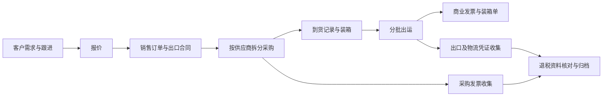
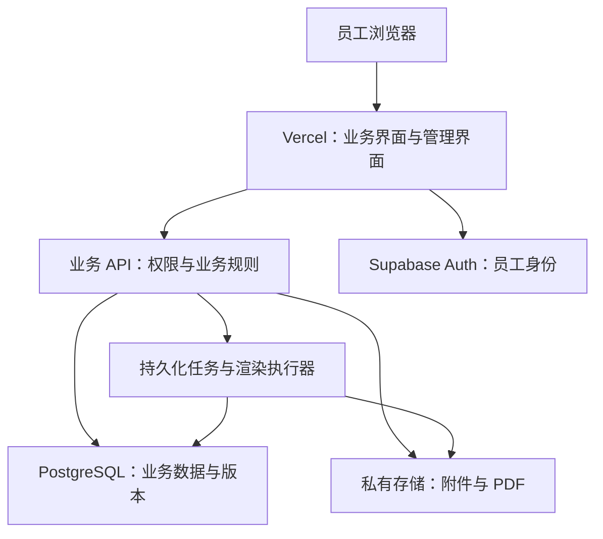

# 外贸工作平台整体开发方案

版本：v0.1（方案评审稿）  
日期：2026-10-23  
适用范围：单公司主体、自营采购出口、接到海外 B2B 客户订单后向国内供应商采购。

本文整理当前已确认的产品方向与架构建议，供需求评审、原型设计和开发拆分使用。本文不代表已完成开发、部署或运行验证。

## 1. 已确认的前提与产品目标

### 1.1 已确认事项

- 公司业务为自营采购出口，服务海外 B2B 客户。
- 目前只有一家公司主体。
- 收到客户订单后采购；第一版不建设完整的备货库存及仓储系统，但需要记录到货、待出运数量和出运分配。
- 公司员工通过程序管理客户资料、跟进进度和产品资料。
- 系统需要生成采购单、外贸单据、合同及退税辅助资料，支持 PDF 下载。
- 系统需要设置签名，具体采用签名图像还是正式电子签约，尚待确认。
- 前端与数据服务分离；当前首选 Vercel＋Supabase。

### 1.2 产品目标

以订单为中心，连接客户、产品、采购、出运、单据和归档。核心数据录入一次，在后续业务中复用，减少重复填写和不同单据之间的差错。

员工进入系统后，应能直接看到需要跟进的客户、即将到期的交货任务、待审核单据及缺失资料。

### 1.3 第一版边界

第一版覆盖内部协作和业务资料闭环，暂不包含客户自助门户、完整库存核算、完整财务总账、自动报关、自动退税申报或通用流程设计器。

外部正式凭证，例如供应商发票、报关单、提单及运单，通过上传或后续合规接口取得。系统生成的辅助表格不能冒充这些凭证。

## 2. 业务流程与核心关系

### 2.1 销售、采购、出运分开管理

销售订单记录客户需求、外币售价、交期和贸易条件；采购订单记录供应商、采购成本、交货及开票要求；出运批次记录实际出货和包装情况。

一张销售订单可以对应多张采购订单、多次到货和多个出运批次。第一版可以限制一个出运批次只属于一张销售订单，以控制操作复杂度；跨销售订单合并出运列为待确认需求。

### 2.2 明细分配关系

通过明细分配记录关联销售需求、采购、到货、出运及发票，而不是只在表头填写订单编号。

例如：客户订购 1,000 件，分别向两家供应商采购 600 件和 400 件，再分两次出运。系统应能回答每次出运对应哪些采购和到货，以及相关资料是否齐全。

需要校验累计分配量，避免超采购、超到货出运或同一数量重复分配。销售单位、采购单位、申报单位不一致时，必须维护明确的换算关系并保留业务快照。

### 2.3 状态分别维护

- 客户跟进：新需求、洽谈、报价、成交、暂缓等，可配置。
- 销售订单：草稿、待审核、已确认、履行中、已完成、已取消。
- 采购与到货：分别跟踪采购确认、部分到货、全部到货及异常。
- 出运：准备中、待审核、已确认出运、已归档。
- 单据：草稿、待审核、已审核、已被新版替代、已作废。
- 退税资料：待收集、缺件、待核对、核对通过、已归档。

订单完成、资料归档及实际退税到账是不同状态，不相互替代。审核中的数据变更应撤回或使审核失效；已审核内容通过新版本变更。

## 3. 用户角色与权限

岗位名称可按实际团队简化，底层权限按动作和数据范围组合。

| 角色 | 主要职责 | 数据范围示例 |
| --- | --- | --- |
| 管理员 | 账号、公司档案、客户分配、模板及授权 | 按授权管理全公司业务 |
| 业务员 | 客户跟进、报价、销售订单及资料补充 | 本人负责或明确共享的客户与订单 |
| 采购人员 | 供应商、采购、到货及采购附件 | 分配给自己的采购业务 |
| 单证人员 | 装箱、出运、单据制作与归档 | 授权订单及出运批次 |
| 财务／审核人员 | 金额核对、发票、退税资料、单据审核 | 授权财务数据和审核范围 |

查看采购成本、查看利润、修改收款账户、审核合同、使用签名和批量导出客户分别授权。界面隐藏不能替代后端权限检查。

单公司主体仍需员工之间的数据权限。管理员修改权限、转交客户及使用印章等操作保留审计记录。权限实现属于需人类审核的核心设计，开发前单独确认权限矩阵。

## 4. 功能模块

### 4.1 我的工作台

- 今日及逾期客户跟进。
- 待审核合同、采购单和出运资料。
- 临近交期、采购未完成、资料缺失提醒。
- 与本人相关的订单及最近操作。
- 点击待办直接进入对应业务，不要求重新查找。

### 4.2 客户与跟进

维护公司名称、国家、地址、联系人、负责人、合作偏好和付款条件。跟进记录包含时间、摘要、下一步动作及下次联系时间。

客户详情展示需求、报价、订单和附件历史。支持客户转交及共享，保留变更记录。第一版不自动发送邮件或消息。

### 4.3 产品与海关资料

维护内部产品编号、中英文品名、规格、图片、材质、用途、销售与采购单位、默认供应商及海关编码资料。

客户商品描述、供应商规格及报关描述分开维护，并建立关联。海关相关信息记录来源、适用日期、核验日期和审核人；具体申报字段按产品类别确认。编码和税率不能仅凭产品名称自动确定。

产品主档更新只改变新业务默认值，历史订单和单据保留原快照。

### 4.4 供应商与采购

维护供应商资料、产品报价、付款条件、交期和开票要求。根据销售明细选择供应商并拆分采购，跟踪未采购、未到货数量及采购异常。

支持到货登记和数量差异记录，不在第一版引入库位、盘点及成本结转。退货、补货和订单取消后的数量冲回规则在开发规格中明确。

### 4.5 报价与销售订单

记录产品、数量、价格、币种、贸易条款及指定地点、付款条件、交期、运保费、折扣和合同条款。

报价确认后转为销售订单，保留报价版本。订单变更记录原因、修改人及受影响单据。

利润功能先展示预计收入、采购成本及已知费用。汇率应记录日期和来源，预计退税与实际到账分开列示；未经财务确认，不将其视为确定收益。

### 4.6 出运与装箱

按出运批次管理实际数量、箱数、包装明细、净重、毛重、体积、唛头、港口及物流附件。商业发票和装箱单使用该批次数据，不能直接套用整张订单数量。

记录实际出运日期和相关凭证。具体运输方式、拼箱和混装规则待业务样例确认。

### 4.7 收付款与发票

第一版提供付款计划、实收实付记录、币种、日期及凭证关联，不替代财务账套。订金、尾款、部分付款分别登记。

采购发票记录收取、核对和业务关联状态，支持通过分配明细关联多笔采购。进项凭证的业务适用性由财务确认，系统只做明确规则范围内的辅助校验。

### 4.8 单据中心

优先支持报价单、形式发票（PI）、出口合同、采购订单／采购合同、商业发票（CI）、装箱单（PL）、报关资料整理表及退税备案目录。

支持按订单、客户、类型、状态和日期筛选，预览及下载指定版本。批量导出需单独授权并记录操作。

### 4.9 退税资料准备与归档

按订单、采购和出运批次收集合同、采购发票、出口及运输凭证。根据财务确认的清单提示缺件，辅助核对品名、数量、金额和关联关系。

生成目录、检查报告及资料包。资料齐全不等于具备退税资格或已申报成功；正式申报及税务系统对接不属于第一版。

### 4.10 系统设置

集中维护单一公司主体的中英文抬头、地址、银行资料、Logo、编号规则、合同条款、模板、角色及签名授权。

公司资料和银行账户变更需审核并保留历史，不回写已审核单据。第一版不提供多主体切换；数据预留公司关联字段不代表已支持多公司或多租户。

## 5. 界面与易用性

### 5.1 信息架构

业务员常用入口为“我的待办、客户、订单”。采购、单证和财务按岗位增加相应入口；管理员增加基础资料和系统设置。

订单详情采用以下页签：

`概览｜商品明细｜采购与到货｜出运装箱｜单据｜收付款与发票｜附件与记录`

大部分操作在订单内完成，单据中心等页面用于跨订单集中处理。

### 5.2 交互要求

- 选择客户、产品和供应商后预填默认资料，并允许在草稿中核对。
- 支持明细复制、批量粘贴及保存常用筛选。
- 自动保存只用于草稿，显示保存结果和并发冲突。
- 缺失字段定位到具体位置；金额和数量差异展示原因。
- 按钮使用“生成采购单”“提交审核”等具体动作名称。
- 重要状态不只依赖颜色，支持键盘操作和清晰的焦点提示。
- 第一版优先电脑端，移动端先保障查看和简单跟进，复杂表格编辑后续评估。

### 5.3 视觉方向

以高密度但清晰的业务表格、稳定导航及明确状态为主。减少装饰性图表和动画，重点保证中英文长文本、数字对齐、表单分组及待办优先级。

## 6. 前端与数据分离架构

### 6.1 首选方案

使用 Vercel 部署网页应用及业务 API，Supabase 提供 PostgreSQL、Auth 和私有文件存储；PDF 与批量打包通过持久化后台任务执行。

前期采用一个代码仓库、一个网页应用和模块化 API。前端与数据服务独立，但暂不拆成多个独立发布的业务系统。

员工通过自建管理界面维护资料，Supabase 控制台仅供授权技术人员运维。

### 6.2 职责划分

| 层级 | 职责 |
| --- | --- |
| 前端 | 页面、输入提示、预览及交互状态 |
| 业务 API | 身份与权限核验、计算、审核、版本、签名授权和任务创建 |
| 数据库 | 事务、外键、唯一约束、精度、分配关系及并发保护 |
| 文件存储 | 原始附件、渲染成果及签名文件的私有存储 |
| 后台执行器 | PDF 渲染、资料打包及任务状态更新 |

普通业务数据默认通过业务 API 访问，登录交由 Auth。文件直传仅使用经授权的受限上传机制。公开数据接口需设置表级授权及行级权限，不留绕过 API 的写入通道。

### 6.3 技术候选与待定项

- 前端及 API：TypeScript、React，Vercel 路线优先评估 Next.js。
- 数据库：Supabase PostgreSQL。
- 登录：Supabase Auth，内部邀请开通账号，关闭自由注册。
- 附件：第一版统一使用 Supabase 私有 Storage，避免同时维护两套文件平台。
- 后台任务：持久化任务表／队列＋可恢复执行器；具体产品在技术验证后确定。
- PDF：版本化 HTML/CSS 模板＋服务端浏览器渲染；执行环境通过样稿验证后选择。

以上是选型建议，尚未安装依赖、创建云资源或核定具体套餐。

### 6.4 Cloudflare 路线

| 路线 | 评估结论 |
| --- | --- |
| Vercel＋Supabase | 当前首选，便于集中开发业务、登录及文件管理 |
| Cloudflare 网页／Workers＋Supabase | 可作为替代，保留 PostgreSQL 数据层，需验证框架和运行时适配 |
| Cloudflare Workers＋D1＋R2 | 可行，但需另行评估认证、权限、事务设计及服务集成成本 |

Cloudflare 提供 HTML／URL 转 PDF 接口，可以作为独立渲染候选；不因已有此能力就默认引入第三个平台。D1 与 PostgreSQL 的运行模型和约束不同，不能视为无成本替换。

## 7. 数据模型与业务一致性

建议按以下业务实体拆分，而非用一张大表承载全部流程：

| 领域 | 主要实体 |
| --- | --- |
| 公司与人员 | 公司档案、员工档案、角色、权限、业务共享关系 |
| 客户 | 客户、联系人、跟进记录、跟进任务 |
| 产品与供应商 | 产品、规格、海关资料版本、供应商、供应商产品报价 |
| 销售 | 报价及明细、销售订单及明细、变更版本 |
| 采购 | 采购订单及明细、销售采购分配、到货及明细 |
| 出运 | 出运批次、出运明细、来源分配、包装明细 |
| 财务辅助 | 收付款计划与记录、采购发票及明细、发票分配 |
| 单据 | 模板及版本、单据及版本、审核记录、文件快照 |
| 签名 | 签名资产、授权、使用申请及使用记录 |
| 归档与运行 | 附件关联、资料清单、归档记录、生成任务、审计事件 |

关键规则：

- 金额采用精确十进制；数量、重量、汇率分别规定精度与舍入顺序，禁止二进制浮点直接计算业务金额。
- 多步写入采用数据库事务；拆单、审核和生成任务具备幂等控制。
- 数量分配在事务中校验，防止并发操作超出可分配量。
- 更新使用版本条件，旧页面不得静默覆盖新数据。
- 编号通过数据库唯一约束和原子分配生成，不依赖浏览器计数。
- 业务记录的作废和冲回保留历史，不直接删除已生效单据。
- 审计记录与业务变更在同一可靠提交路径中产生；普通员工不能修改审计事件。

## 8. 单据、PDF 与签名

### 8.1 单据生成流程

`选取业务范围 → 校验资料 → 生成预览 → 审核 → 固定版本 → 后台生成 PDF → 私有保存 → 授权下载`

草稿预览可带水印。正式 PDF 根据已审核数据快照和模板版本生成，生成后计算文件摘要并登记关联关系。

修改数量、价格、银行资料或合同条款时，展示受影响单据，生成新版本。历史正式文件继续保留，并标注已被替代或作废。

### 8.2 后台任务要求

- 任务状态包含等待、处理中、成功、失败。
- 任务持久化，不依赖浏览器页面保持打开。
- 执行器中断后可恢复，通过任务租约／超时接管避免永久卡住。
- 通过幂等标识避免重复生成正式版本。
- 重试仅处理适合重试的渲染故障；审核、签名和第三方签约不能因重试重复执行。
- 打包任务只包含发起人有权取得的文件。

### 8.3 PDF 排版验收

检查中文字体、中英文混排、长品名、跨页表格、重复表头、页码、金额精度、签名位置和纸张尺寸。预览与下载均使用同一最终文件检查。

渲染器只读取受控模板和经校验数据，限制外部资源访问。签名或银行资料不得传入无授权的第三方模板服务。

### 8.4 签名与印章

签名图像功能包括受控上传、授权范围、模板位置、审核和使用记录。签名原图不开放给普通业务员下载，使用记录绑定具体单据版本。

正式电子签约属于另一项能力，需要身份、意愿、完整性及证据链保障。插入签名图片不能据此认定为可靠电子签名。是否接入专业签约服务及跨境合同适用要求，待公司确认后单独设计。

## 9. 安全、部署与维护

- 账号按内部员工邀请制管理；高权限账号优先启用多因素认证。
- API 核验动作与数据范围，数据库权限作为第二道约束。
- Supabase 高权限密钥仅存服务端，不进入前端包、Git 或日志。高权限访问需显式授权，不能假设其受 RLS 限制。
- 客户附件、合同、发票和签名使用私有存储，下载需授权；短时链接在有效期内仍可被持有者使用，应控制有效期。
- 审计记录业务 ID、操作者内部 ID、动作和版本，不记录联系人正文、密钥或完整合同内容。
- 测试、预览与生产隔离；预览部署不连接生产数据，不使用真实客户资料作为测试夹具。
- 数据库迁移进入共享环境后只追加；前端回滚不等于数据库回滚，发布前准备兼容和恢复方案。
- 数据库与附件分别备份，配置和模板源代码一并纳入恢复范围；备份周期、保留期和恢复目标待确认。
- 监控 API 错误、任务失败、文件不可访问和备份失败，不将敏感正文发送给错误收集服务。
- API 执行区域尽量靠近数据库。员工实际网络下完成登录、查询、上传和下载测试后确定区域。
- 套餐、调用费用、存储和备份费用在部署前核定，并设置预算与告警；本文不承诺免费运行或固定费用。

客户资料和合同存储地域、访问范围及保留期限需要在上线前评审。当前未执行任何真实数据迁移、生产写入或付费调用。

## 10. 分阶段交付

| 阶段 | 范围 | 验收门槛 |
| --- | --- | --- |
| 0：需求与原型 | 脱敏模板、虚构完整样例、字段映射、权限矩阵、关键页面原型 | 业务、采购和财务确认流程与字段 |
| 1：核心闭环 | 登录权限、客户跟进、产品供应商、报价、销售、采购、基础出运及 PDF | 能完成一笔业务的录入、采购和单据下载 |
| 2：可靠试用版本 | 完整分批出运、审核、版本、受控签名、发票关联、退税资料归档、备份恢复 | 复杂场景和权限测试通过，关键资料可追溯 |
| 3：效率与集成 | 批量导入、模板完善、利润、签约及财务物流接口 | 每项按实际需求和接口条件独立验收 |

阶段 1 用于验证流程，不直接认定可承载正式业务。正式试用需要阶段 2 中适用的权限、审计、备份和版本能力达到验收标准。

本方案不承诺交付天数。工期在团队配置、模板数量、异常场景和验收范围确认后估算。

## 11. 提高迭代速度的原则

1. 先用一笔虚构业务贯穿全流程，尽早验证数据能否复用。
2. 高频变化的抬头、条款、编号和清单配置化，核心权限和计算规则通过代码及测试维护。
3. 第一版维护少量审核过的固定模板，暂缓通用拖拽模板设计器。
4. 使用模块化单体架构，避免早期拆分微服务。
5. 优先原生数据库、标准文件格式和清晰 API，降低未来迁移成本，但不承诺更换平台无需适配。
6. AI／OCR 只在后续作为录入辅助，结果需人工核对，不直接决定海关编码、合同条款或退税资格。

## 12. 验收与验证计划

### 12.1 关键业务场景

- 一张销售订单拆给两家供应商，分两次到货、两次出运，累计数量准确。
- 业务员不能读取未授权客户、采购成本或签名原图。
- 重复点击拆单、审核或生成按钮，不产生重复采购单、审批或正式单据版本。
- 两人同时分配采购或出运数量，不能超额；两人编辑时能识别旧版本冲突。
- 修改产品、客户地址或银行资料后，旧合同不变化。
- 采购取消、数量变更、补货及出运调整有明确的回退和重新审核路径。
- 多页 PDF 的长文本、表格和签名位置正确。
- 任务中断后可恢复；失败时不错误显示“已生成”。
- 资料缺件可定位到具体业务；资料包不包含越权文件。
- 在隔离环境恢复数据库和附件后，订单与文件关联仍然有效。

### 12.2 验证分层

- 本地：金额、数量、状态、权限、并发、幂等及失败路径测试。
- 集成：隔离数据库、登录、存储、事务和 PDF 实际执行验证。
- 预发：使用虚构业务，从员工登录到最终资料包完成端到端验证。
- 上线：另行批准部署及真实数据处理，进行受控验收。

当前仅完成方案整理与文档结构检查；未执行上述产品测试或部署验证。

## 13. 待确认事项与下一步

| 待确认项 | 对设计的影响 |
| --- | --- |
| 员工人数、岗位及主要访问地区 | 权限、并发、部署区域及网络验证 |
| 常用单据样式和数量 | 模板范围、字段和 PDF 排版工作量 |
| 一个出运批次是否合并多张销售订单 | 出运模型和单据取数范围 |
| 运输方式、混装及包装规则 | 出运和装箱录入方式 |
| 业务币种、单位换算及金额舍入规则 | 金额和数量一致性 |
| 财务确认的企业退税适用流程及资料清单 | 归档规则和辅助校验边界 |
| 签名图像或正式电子签约 | 审批、证据链、集成及费用 |
| 现有客户／产品数据的格式 | 导入、清洗和去重范围 |
| 备份恢复目标、预算及维护责任人 | 套餐、运行与恢复方案 |

下一步优先完成一笔虚构订单样例与现有空白单据模板的字段映射，再设计客户详情、订单详情、采购拆单和 PDF 预览四个关键页面。不要提供含真实联系人、银行账号或签名原图的样本到聊天或 Git 中。

## 14. 参考资料

以下官方资料用于支持架构和能力判断。套餐、限制及政策适用范围在实施时应再次核验。

- [Supabase 数据访问安全](https://supabase.com/docs/guides/database/secure-data)：数据库权限与服务端密钥边界。
- [Supabase 私有文件存储](https://supabase.com/docs/guides/storage/buckets/fundamentals)：私有桶及受限下载。
- [Vercel Functions 区域配置](https://vercel.com/docs/functions/configuring-functions/region)：服务与数据库位置选择。
- [Cloudflare D1 限制](https://developers.cloudflare.com/d1/platform/limits/)：评估替代数据库时的运行约束。
- [Cloudflare PDF 接口](https://developers.cloudflare.com/api/resources/browser_rendering/subresources/pdf/methods/create/)：HTML／URL 渲染 PDF 候选能力。
- [Playwright PDF 接口](https://playwright.dev/docs/api/class-page#page-pdf)：服务端打印模板实现参考。
- [中华人民共和国电子签名法](https://www.miit.gov.cn/datainfo/fgk/gytxyxxhfg/fl/art/2020/art_60e5aadb101c48bf94d06a99ff032361.html)：签名图像与可靠电子签名的边界。
- [税务部门 2026 年出口退税管理办法解读](https://shanghai.chinatax.gov.cn/zcfw/zcjd/202602/t479289.html)：备案资料设计参考，具体适用由财务核定。
