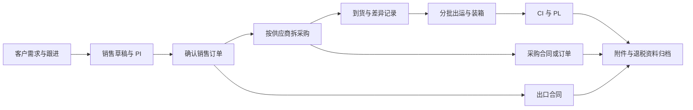
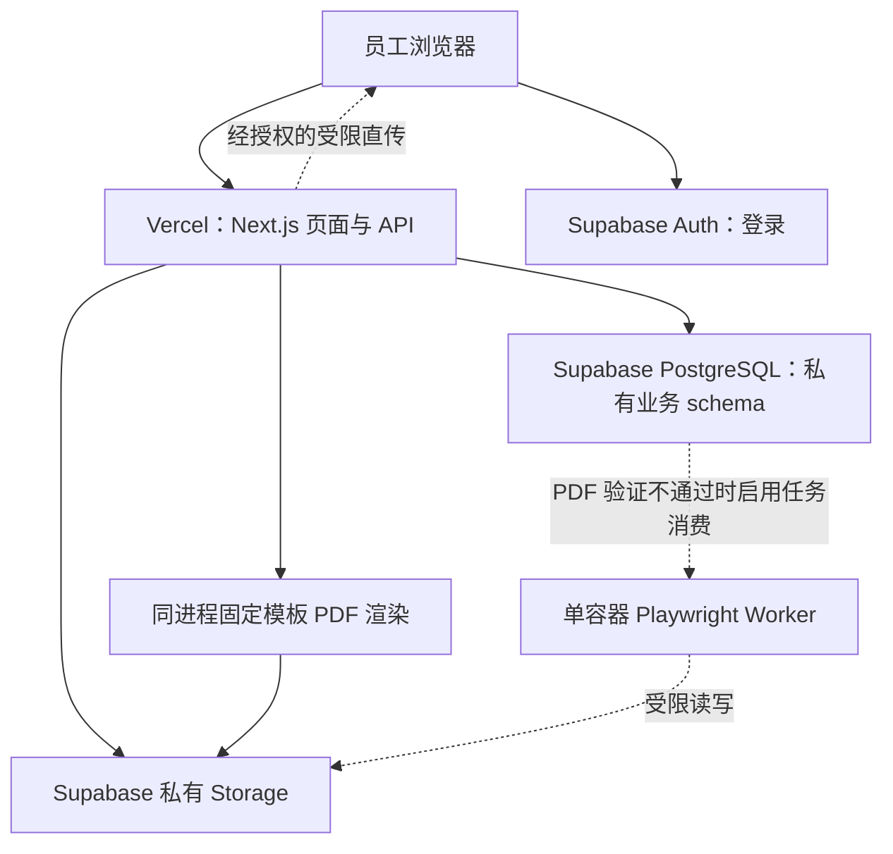

> 历史方案提示（2026-10-25）：本文保留设计历史，技术栈、权限、进度和安装方式可能已变化。当前实现以 README.md 与 docs/development/思链台开发总结与维护手册.md 为准；本地化路线见 docs/architecture/思链台本地化与二期扩展方案.md。请勿直接按本文旧部署步骤安装当前版本。

# 外贸工作平台最终开发方案

版本：v1.0｜日期：2026-10-23｜状态：综合评审后的开发基线，待业务确认后拆分实施计划。

本方案整合原始需求与七份审核材料，目标是实际可落地、总成本可解释、后续能持续迭代。对应取舍见《多方案审核比较与取舍说明-2026-10-23.md》。本文未执行开发、部署、付费调用或真实业务数据处理，不构成上线验收结论。

## 1. 执行结论

建设一个内部网页工作台，以订单为核心，支持客户跟进、接单后采购、分批到货与出运，并从统一数据生成单据。

采用模块化单体：一个仓库、一个网页应用、统一业务 API、PostgreSQL 和私有文件存储。前端与数据服务分离，员工通过自建管理界面维护资料，不操作数据库控制台。

部署验证主线为 Vercel＋Supabase，尊重前期确认方向。先通过办公网络、数据地域和 PDF 样稿验证，再批准生产路线。固定模板优先尝试 React-PDF 同步生成，生成意图及结果状态持久化；不满足验收则在技术验证阶段改用一个容器化 Playwright worker。

首发缩小功能，但权限、数量一致性、幂等、正式单据快照、审计及数据库与附件恢复不能后移。合同、受控签名和退税资料整理安排在明确的后续里程碑，完成这些以后才称为满足本项目完整需求。

## 2. 已确认事实、假设及待决事项

### 2.1 已确认事实

- 一家公司主体，自营采购出口，海外 B2B。
- 收到客户订单后向国内供应商采购。
- 员工需要维护客户及跟进、产品和海关编码资料。
- 需要采购单、外贸单据、合同、退税辅助资料和 PDF 下载。
- 需要设置电子签名；签名图片或正式电子签约的选择尚未确认。
- 前端与数据服务分离，前期接受 Vercel＋Supabase 方向。

### 2.2 不能直接当事实的材料内容

员工数、单人 SOHO、专职团队、已有服务器型号与地区、已有客户模型、抓取工具、邮件平台及计算器接口均未确认。不据此制定角色、复用机器或接入外部系统。

### 2.3 规划用假设

仅用于评估：5—10 个员工账号、峰值 3 人编辑、每月 100 张销售订单、常规每单不超过 50 行、每月 1,000 次 PDF、第一年文件不超过 30GB。超出时重新测试，不是容量承诺。

虚构样例可使用 USD／CNY 和同单位商品。生产允许币种、单位、小数精度、财务舍入及贸易条款必须经业务确认，不能靠“先默认再改”直接处理正式订单。

## 3. 目标与范围

### 3.1 核心流程



销售、采购、到货、出运分别记录，客户跟进状态不与订单状态混用。

### 3.2 最小可正式试用版本 M1

| 功能 | 首发交付 |
| --- | --- |
| 员工 | 邀请、登录、停用、固定角色及数据范围，管理员 MFA |
| 客户 | 客户、联系人、负责人、共享、跟进和下次跟进 |
| 主数据 | 公司、产品、供应商、中英文描述、单位、海关资料与核验标记 |
| 销售 | 销售草稿、明细、币种、价格、交期、条款、确认与受控变更 |
| 采购到货 | 一销售行拆给多供应商，部分到货、异常数量、取消剩余采购 |
| 出运装箱 | 一批一销售订单、来源追溯、分批出货、包装明细 |
| 单据 | 四种：PI、采购订单 PO、商业发票 CI、装箱单 PL；固定模板 |
| 可靠性 | 单级确认、不可变版本、幂等、并发、审计、附件私有及联合恢复 |
| 资料 | 外部合同、发票、物流凭证上传；最简缺件清单 |
| 导入 | 客户、产品、供应商固定 CSV 模板，预览、错误报告、确认导入 |

初始报价通过销售草稿和 PI 完成，不另建完整报价版本系统。PI 不能自动代替出口合同；M1 的合同沿用现有签署流程并上传。

### 3.3 完整需求版本 M2

- 固定出口合同和采购合同模板，条款选择与审核。
- 签名／印章设置、授权、单据级使用确认和使用记录；正式电子签约按第 11 节决策。
- 收付款登记、采购发票登记及业务关联，不做财务总账。
- 财务确认的退税资料清单、缺件定位、目录及资料包下载。
- 工作台补齐合同待审、缺发票、归档缺件等待办。

M1 可在授权后有限试用，但不等于完整需求完成；M2 验收通过才满足合同、签名设置和退税资料准备的完整范围。

### 3.4 按需后续 M3

独立报价版本、利润与汇率分析、复杂单位换算、跨订单合并采购／出运、邮件物流财务接口、OCR、客户门户。每项独立论证，不预建通用平台。

不做自动 HS 归类、退税资格判定或未经确认的税务申报。报关单、提单、供应商发票等外部正式凭证只能上传或通过授权接口取得。

## 4. 界面与操作体验

业务员主导航：我的待办、客户、订单。运营增加采购与出运集中列表；管理员增加基础资料、账号和设置。单据中心用于跨订单检索，不要求员工离开订单完成常见动作。

订单详情页签：`概览｜商品｜采购与到货｜出运与装箱｜单据｜附件与记录`。M2 增加财务资料页签。

关键操作：选产品预填描述和单位；选择供应商批量拆采购；从已验收到货中分配出运；校验缺项定位字段；单据页直接预览与下载指定版本。

首发使用明确“保存”按钮，不做复杂自动保存。明细支持复制、粘贴、键盘导航和清晰校验；离开未保存页面给提示。按钮使用具体动作名，状态同时使用文字与颜色。

草稿、已确认、生成失败、已作废清晰区分。列表支持负责人、交期、客户和状态筛选，保存常用视图可后补。电脑端优先，手机先保证查看和跟进。

管理员可编辑公司抬头、银行资料和条款，版式由受控模板发布维护，不建设任意 HTML 编辑器或拖拽模板系统。

## 5. 部署方案和决策门槛

### 5.1 推荐主线 A



主应用与管理页面同一部署；数据服务独立。普通业务浏览器只调用业务 API，不直接读写业务表。身份登录和经授权的文件直传属于明确的例外。

Supabase PostgreSQL、Auth、Storage 为当前数据平台。区域在候选亚太区域中实测决定；不把“新加坡一定 50—100ms”当保证。Vercel API 尽量靠近数据库。

### 5.2 G0 前置验证

| 验证 | 操作与输出 | 建议判据，需业务确认 |
| --- | --- | --- |
| 网络 | 办公网络至少 3 个工作日、多个时段，测试登录、查询、1MB/10MB 上传下载；记录网络、区域、样本数、P50/P95 和失败 | 每类关键交互至少 100 次总样本，无持续不可达；交互成功率目标 ≥99%；普通列表端到端 P95 ≤3 秒；文件传输单独评估 |
| 数据地域 | 列数据类别、联系人／员工个人信息、合同约束、备份位置与第三方访问 | 责任人确认允许的存储和处理地域；不以“外贸”或“境内”直接推导合规 |
| PDF | 用虚构数据套空白样稿：长品名、中文、100 行压力样例、重复表头、页码及未来签名位 | 常规模板预览与正式文件排版获认可；建议同步 PDF P95 ≤10 秒，并在实际函数资源限制内有余量 |
| 事务 | 两人竞争剩余量、重复确认、中途失败 | 无超配、重复和半成品业务写入 |
| 恢复 | 恢复虚构订单与附件到隔离环境 | 关联、摘要、权限及文件可用；记录实际耗时和缺口 |

上述为建议验收目标，尚未实测。样例超出范围或测试失败时调整路线和范围，不降低数据正确性要求。仅允许本地离线验证时，先完成样稿与测试设计；创建项目、付费测试和外部写入须按规范另行授权。

### 5.3 主线不通过时的后备 B

网络或地域不通过：停止 A 的生产推进，评审同一业务应用在允许地域的容器部署，配 PostgreSQL、私有对象存储和一个 worker。身份改用成熟认证组件，经独立权限验证，不手写密码和会话安全。

有明确维护人时可考虑数据库自托管；没有则优先托管 PostgreSQL。Cloudflare 可用于 DNS 或经验证的访问入口，但不保证访问稳定，不缓存私有业务内容。

只实施一条选定路线。改主机不等于零迁移：认证、文件、数据库角色和备份都要重新适配和验收。不复用未经核实的服务器，不与独立官网混用数据库、密钥或上传目录。

## 6. 工程结构与技术基线

| 项目 | 基线 |
| --- | --- |
| 应用 | Next.js＋TypeScript，模块化单体，页面与 API 同仓 |
| 表单和列表 | React Hook Form＋Zod；成熟表格方案；组件库统一，不重复引入 |
| 数据访问 | Drizzle＋PostgreSQL 连接池，显式事务；池模式及驱动兼容在 G0 验证 |
| 迁移 | SQL 迁移入仓库；Supabase 平台迁移历史作为单一执行入口；不同时维护两套迁移账本 |
| PDF | 首选 @react-pdf/renderer＋授权中文字体；不通过则固定 Playwright 镜像 |
| 测试 | Vitest 类单测工具＋真实隔离 PostgreSQL 集成测试＋少量 Playwright E2E |
| 文件 | Supabase 私有桶，服务端签发受限上传与短时下载 |
| 监控 | 优先平台指标＋脱敏应用错误；确有需求再引入第三方监控 |

依赖版本、许可证及运行时组合在 G0 核验后锁定，不追随未经验证的最新版。新增依赖和 CI／工具链按项目规范先审批。

建议目录，暂不强制建设内部包平台：

```text
src/app/                 页面与 API 入口
src/modules/             customers、sales、purchasing、shipping、documents
src/server/              auth、authorize、db、files、audit
src/domain/              金额、单位、状态、DTO 等纯规则
src/templates/           固定 PDF 模板及版本
supabase/migrations/     唯一迁移历史
tests/                   单元、集成、端到端
docs/                    数据字典、权限、决策、发布及恢复
worker/                  仅选择容器路线时创建
```

Drizzle 辅助生成 SQL，迁移审阅后纳入唯一迁移目录；不自动在生产应用新迁移。实际 CLI 命令通过已安装版本的 help 确认。

## 7. 权限、身份与文件边界

### 7.1 三个固定权限包

| 动作 | 管理员 | 业务员 | 运营 |
| --- | --- | --- | --- |
| 客户／销售 | 全公司授权范围 | 本人负责或明确共享 | 仅执行任务所需资料 |
| 产品资料 | 维护 | 查看、选取 | 授权维护 |
| 供应商与采购价格 | 默认可见 | 默认不可见 | 采购授权者可见 |
| 采购、到货 | 可操作 | 查看脱敏进度 | 授权任务内操作 |
| 出运、装箱 | 可操作 | 查看本单、提交资料 | 授权任务内操作 |
| 正式单据确认 | 可操作 | 提交 | 提交 |
| 公司／银行／账号 | 管理并留痕 | 不可 | 不可 |
| 签名、财务资料、批量导出 | 显式授权后操作 | 默认不可 | 显式授权后操作 |

这是建议矩阵，需人类审核。实际存在独立财务时从权限包拆出，不需要重建权限引擎。一人可兼任，但每人独立账号。普通业务员不能因为被授权采购，就顺便取得所有客户销售价格。

### 7.2 单一业务授权路径

API 核验可信身份、员工启用状态、动作、资源范围和字段。查询只返回允许的 DTO，特别是采购成本、利润和银行资料。角色不从员工可编辑的 user_metadata 获取。

业务表位于未向 Data API 暴露的私有 schema；撤销 anon/authenticated 对业务表和函数的访问。应用通过连接池使用专用 app_backend 数据库角色，不使用 postgres、超级用户或 BYPASSRLS。API 承担员工级授权，此数据库账号本身不代表某个员工，必须承认服务端仍是关键边界。

业务规则不再完整复制到 RLS。若局部需要 RLS，必须定义实际角色与策略并测试，不能对同一账号“默认拒绝全部”又期待它正常操作。角色不能修改 schema、权限和审计历史。迁移角色独立。

Supabase 高权限管理凭据仅供隔离的邀请管理、文件授权等适配器，按实际能力使用；每次先做业务授权，禁止开放任意表、路径或对象代理。G0 验证自定义角色、连接池和 Storage 访问闭环，不通过则不得带着默认高权限进入业务开发。

状态变更、数据范围、签名授权及鉴权实现均属于需人类审核的核心设计。

### 7.3 停用与附件

每次敏感操作检查员工状态和当前权限，不能只相信旧 JWT。停用后撤销会话并阻止新业务及新下载授权；已发短时链接可能仍有效，应控制期限。

上传先创建受权附件意图，限制业务对象、路径、大小和类型，成功后校验文件元数据并确认关联。不能仅信浏览器提供的文件名、MIME 或 order_id。用户文件不覆盖正式 PDF 和签名原图路径。

下载重新检查资源权限；批量导出不能混入越权文件。签名原图不向普通员工签发下载链接。私有响应禁止共享 CDN 缓存。

## 8. 最小数据模型与数量规则

### 8.1 核心实体

| 领域 | 实体与关联 |
| --- | --- |
| 公司／员工 | company_profile、staff、固定权限、customer_shares／任务授权 |
| 客户 | customers、contacts、followups |
| 产品／供应商 | products（含海关核验字段）、suppliers、按需供应商报价 |
| 销售 | sales_orders、sales_order_lines |
| 采购 | purchase_orders、purchase_order_lines；每采购行只关联一销售行 |
| 到货 | receipts、receipt_lines；每到货行关联一采购行，记录验收及异常 |
| 出运 | shipments、shipment_lines、shipment_sources；来源连接验收到货行 |
| 包装 | packages、package_lines；连接出运行，支持一商品多箱及混装记录 |
| 单据 | documents、document_versions；快照、审核及渲染状态 |
| 文件／运行 | attachments、显式业务关联、audit_events、idempotency_requests、number_sequences、import_batches |
| M2 | payment_records、purchase_invoices、资料清单与检查结果、签名资产与使用记录 |

不以“必须 17 张表”作为验收目标。外键、唯一约束、正数检查和业务不变量比表数重要。附件关联使用受约束关联表或可校验外键，避免任意 type/id 导致孤立文件。

首发一出运批次只属于一销售订单，同时每个出运行保留销售行关联，服务端强制一致。以后合单可能涉及收货人、币种、条款、单据和权限，必须独立设计，不能宣称只是放开 UI。

### 8.2 数量不变量

1. 确认采购数量＋有效采购草稿预留不超过销售需求量；同一需求的草稿也需占用，作废释放。
2. 已验收和异常到货累计不超过采购有效量；不允许用直接超收修正业务错误。
3. 只有验收可用数量可分配出运；异常量单独记录。
4. 已出运消耗＋有效待出运预留不超过来源到货可用量，也不超过销售需求。
5. 出运草稿保存来源分配时占用，撤销释放；确认出运将预留转为消耗，不二次扣减。
6. 包装明细按商品汇总与出运行相等；净毛重和体积记录维度一致，不能把每箱值误当总值。
7. 减少上游数量不能低于有效下游占用；数据修改通过命令处理，禁止负数备注“冲平”。

完整到货流水保留，不仅维护一个可覆盖的 arrived_qty。累计字段可作缓存，但以明细核对并有一致性测试。

### 8.3 明确异常处理

| 场景 | 首发规则 |
| --- | --- |
| 草稿错误 | 可改，受版本与下游占用校验 |
| 采购未到货取消 | 取消剩余部分，释放对应预留，历史保留 |
| 已有到货再取消采购 | 不整单删除；只取消未履行量，已有量转异常处理 |
| 到货录错且未被出运占用 | 受控冲回后重录，审计关联原记录 |
| 出运草稿作废 | 释放来源预留，版本保留 |
| 已确认但尚未实际出运 | 管理员受控撤销确认，作废依赖的正式版本并提示业务核查，不删除 |
| 已实际出运后更改单据 | 新版本并关联原版，不改变已出运实物记录 |
| 实物退回、跨订单调货、超采超收 | 首发阻断常规路径，建立异常记录交由负责人处理；高频场景在 G0 纳入范围 |

异常未纳入时，保留原有业务流程兜底；不得人工直接改数据库维持表面平衡。

## 9. 事务、精度与版本

API 服务层通过同一连接的一次数据库事务执行复杂命令：确认、拆采购、登记到货、预留出运、撤销、审核和任务创建。事务包含业务写入、幂等结果和审计，任一步失败整体回滚；不把多个远程 SDK 请求拼成事务。

按固定 ID 顺序锁定上游销售行及来源行，事务内重算余量再写入。所有竞争入口采用相同锁协议。只锁子表已有分配行不足以阻止新插入竞争。数据库函数可用于集中命令，但不强制为每个 CRUD 写 RPC。

幂等键绑定操作者、命令类型、规范化请求摘要，同键不同内容拒绝。唯一约束和事务防止重复确认；不依赖禁用按钮。可编辑订单、采购、出运表头有 version，旧版本更新返回明确冲突。

### 9.1 金额规则

遵循完整档规则：已结算业务金额以币种最小单位整数存储，例如 amount_minor＋currency_code＋minor_unit_scale；使用 bigint 或足够范围的精确整数列。单价、数量、换算因子和汇率用精确 NUMERIC，并通过十进制字符串传输。

应用用十进制计算单价×数量，再按批准币种规则舍入为最小单位整数，合计使用整数累加，不使用 JavaScript number 直接算钱。minor_unit_scale 随业务快照保存，不能假设所有币种两位。

行舍入／总额舍入、折扣、运保费和税额规则由财务确认。首发建议先行后合计、无隐藏小数调整；差额必须有明确调整行。预计退税不并入确定利润。

### 9.2 版本策略

- 主数据：当前值＋关键变更审计，不为每个字段建设历史版本树。
- 订单：当前版本号＋确认快照＋受控变更记录，存在下游时不能无条件退回草稿覆盖。
- 单据：documents 定义类型和业务范围，document_versions 保存不可变内容快照、模板版本、确认人、文件路径和摘要。
- 模板：源码入 Git，有模板标识和版本；历史版本可追溯，不在线编辑任意代码。
- 银行和公司变更：权限控制、显式确认、审计，仅影响新草稿默认值。

编号由数据库原子分配和唯一约束保证，允许合理断号，不使用 max+1。

### 9.3 状态与确认

| 对象 | 最小状态 | 规则 |
| --- | --- | --- |
| 销售／采购 | 草稿、待确认、已确认、已完成、已取消 | 履行数量由明细推导；不让员工手选“已全部到货” |
| 出运 | 草稿、待确认、已确认、已出运、已作废 | 已确认不等于实际离港；实物出运事件单独记录 |
| 单据版本 | 草稿、待确认、已确认、已被替代、已作废 | 正式内容确认后不可覆盖，渲染状态独立 |
| 资料清单 | 待补、待核对、已核对 | 不推导税务资格或到账 |

首发只做固定单级确认，不做多级流程设计器。管理员默认确认，其他人员提交；是否允许制单人确认自己的单据须业务明确批准并记录，不能因人数少静默放开。存在已生效下游时，撤销必须走第 8.3 节的受控流程。

## 10. PDF 生成与任务恢复

### 10.1 固定模板选择

首选 React-PDF：模板写成专用组件，不把 HTML/CSS 模板误认为可直接复用。字体经过授权及缺字检查。若样稿不达标，改为 HTML/CSS＋Playwright，并记录模板重做成本；只维护一种正式渲染路线。

Vercel 并非不能运行 PDF，容器也不是自动更便宜。G0 根据实际模板、体积、冷启动、耗时、费用和维护责任作出选择，不依赖未经核对的函数时长数字。

### 10.2 同步路线仍需持久化

1. 校验权限和来源版本，在短事务内冻结 document_version，写生成状态 pending 和幂等信息。
2. 请求认领该版本的生成权，提交事务后渲染；不在长事务里运行 PDF。
3. 上传不可覆盖的版本路径，校验摘要，再登记可下载成果。
4. 失败记录错误分类；请求中断留下状态，可在下一次打开或授权重试时回收过期生成权。
5. 最终完成更新校验生成 token，旧执行者不能覆盖新结果。上传成功但登记失败的孤立对象按受控清理流程处理。

应用页面明确显示“已审核／待生成／生成失败／可下载”，不能把审批通过当文件存在。生成失败重试复用原快照，不重复审核、付款或用章授权。

### 10.3 容器路线的明确落点

仅在 G0 选择后启用：在批准地域的一项常驻容器服务运行 Node.js＋Playwright＋固定中文字体，默认一个执行进程、有限并发。不假设已有可用服务器。

jobs 表与数据库同处，包含任务类型、不可变快照引用、去重键、状态、尝试次数、下次执行时间、租约、token 和错误码。短事务认领、执行续租、过期接管、完成校验 token。按至少一次执行＋幂等设计，不承诺恰好一次。

PDF 和打包为同一 worker 的任务类型，不额外引入 Redis、Kubernetes 或微服务。容器内存、CPU、超时及费用通过压力样例核定。

若渲染或签约服务调用收费且结果不确定，按规范做预算预占、原始回执和对账，不能不分情况自动重试扣费调用。

### 10.4 文件验收

PI 来自销售确认版本，PO 来自采购确认版本；CI 与 PL 来自对应出运批次。正式预览和下载为同一文件；草稿预览清楚标注非正式。

验收中文／英文、长描述、多页表头、页码、金额、包装汇总、唛头、A4／实际纸张和签字区域。哈希用于内容校验，不代表文件不可篡改或具备法律签署效力。

## 11. 合同、签名与退税资料

### 11.1 合同

M2 交付固定出口合同及采购合同模板。明确销售方、买方、商品、付款、交付、争议和适用条款来源，由业务负责人审核文本，程序不自行承诺商业条件。

系统生成合同与签署完成分别标记。已签署文件作为独立附件保留，与系统版本关联。

### 11.2 签名设置

默认实施方案为受控签名／印章图像：上传、停用、授权使用者、模板位置和单据级使用记录。使用绑定文件快照，确认后才能渲染，重试不扩大授权。签名图片不进入源码、测试、日志或公共桶。

收件人拿到 PDF 后可能提取可见签名，扁平化不能防复制。签名图像不宣称等于可靠电子签名。

如果公司要求可靠电子签名或客户在线签署，必须在 G0 确认，改为专业签约服务专项：身份、意愿、证据、回调幂等、验签、地域和费用。此时不能以交付图片功能代替签约需求。

### 11.3 退税资料

财务提供适用资料清单和口径，系统按订单／采购／出运关联附件，检查缺件和明确字段一致性，生成目录与资料包。

采购发票先登记票号、日期、金额和业务关联，不首发建设发票行级数量核销引擎。清单有配置版本，历史归档保留使用版本及检查人。

“资料齐全”“已申报”“退税到账”分开，不自动推断资格。法定保留期、申报流程和适用要求由责任人核验；正式税务接口另行立项。

## 12. 分阶段开发与验收

| 阶段 | 交付切片 | 出口 |
| --- | --- | --- |
| G0：范围与技术验证 | 权限、异常、币种、空白模板、网络、地域、PDF、事务及恢复探针 | 有结论的范围表、选型记录、样稿和验证证据；失败先调整 |
| S1：基础可操作 | 登录、员工状态、客户跟进、公司产品供应商、CSV 样例导入 | 两账号完成授权维护；越权拒绝；仅虚构数据 |
| S2：销售与采购 | 订单确认、拆采购、预留、到货及冲回 | 1,000 件拆为 600＋400，分次到货；并发无超配 |
| S3：出运与单据 | 来源预留、包装、分批出运、PI/PO/CI/PL、快照和失败重试 | 两批出运数量正确，四种 PDF 获业务确认 |
| S4：M1 试用门槛 | 端到端、权限回归、恢复、监控、操作手册和受限导入 | P0 关闭并取得正式试用授权；保留原流程兜底 |
| S5：M2 完整需求 | 合同、签名、发票与收付款登记、退税目录和资料包 | 原始完整需求逐项验收，未完成项不能宣称完成 |
| S6：M3 优化 | 报价、利润、集成及复杂业务 | 每项按收益与成本独立批准 |

每片可演示和独立验收，但不要求未达安全门槛的每个阶段都导入真实业务。文档不是部署授权；真实数据处理、生产写入和外发仍按开发规范单独批准。

### 12.1 工作量估算

假设一名熟练全栈工程师、业务及时参与、固定四种 PDF、无复杂换算／直发／合单。估算为工作量区间，非承诺：

| 工作包 | 人日 |
| --- | ---: |
| G0 范围、原型与探针 | 5—8 |
| S1 身份、权限、主数据、初始导入 | 8—12 |
| S2 销售、采购、到货及异常 | 10—15 |
| S3 出运、包装、单据和生成恢复 | 10—15 |
| S4 联调、回归、恢复、试用准备 | 7—10 |
| M1 小计 | 40—60 |
| M2 合同、图像签名、财务资料和退税归档 | 12—20 |
| 完整需求合计 | 52—80 |

另留约 20% 风险容量，不与已有报价中的风险费重复计算。AI 辅助不等同可独立维护工程师。按每周 5 个有效开发日，完整范围含缓冲约 13—20 周；兼职、模板返工和业务等待会延长。双人不能简单减半，需另计协作和串行验证。

范围冻结后逐项重新估算，若工作量超预算，优先减少低频功能和模板，保留可靠性门槛。

## 13. 经济性与预算

### 13.1 已核验的基础牌价

2026-10-23 官方页面显示 Vercel Pro 基础价 $20/月、Supabase Pro 从 $25/月起。前者按平台协作权限和用量计费，不按业务员工数计费；后者额外项目计算资源、流量及附加能力可能增加账单。参见 [Vercel 价格](https://vercel.com/pricing)、[Supabase 价格](https://supabase.com/pricing)。

因此 $45/月只是基础组合，不是完整运行费或硬上限。正式业务不以闲置可暂停的免费项目作为保障。预发额外项目、独立备份、邀请邮件、文件下载及渲染费用必须纳入。

### 13.2 规划预算，非报价

| 费用 | 规划口径 |
| --- | --- |
| A 两平台、无常驻 worker | 可先讨论 $60—100/月资源预算，含必要预发、备份和少量弹性，需逐项报价核定 |
| A＋容器 worker | 在上项外预留 $10—30/月作为询价占位；规格、流量和地域未报价 |
| B 境内容器＋数据库＋对象存储 | 暂以 ¥300—800/月作为询价范围，不含维护人力，不宣称比 A 固定便宜 |
| 维护 | 初期规划 1—2 人日/月，记录实际时间后调整；功能开发另计 |
| 完整自研开发 | 52—80 人日×综合人日单价×约 1.2 风险系数；需确认单价包含哪些职责 |

数学示例：人日综合单价 ¥1,000，则开发规划 ¥62,400—96,000；单价 ¥1,500 则 ¥93,600—144,000。不是市场报价，也不能用 AI 订阅费代替审查、测试和维护成本。

首年 TCO＝开发＋业务整理培训＋12×（云资源＋维护）＋后续需求和停机迁移准备。自建的服务器折旧、安全补丁、备份和恢复人力不能计为零。

预算告警不是所有产品都支持的硬限额。付费前逐项核实可执行的限额、停用行为与账单延迟；无法验证硬上限时，不发起相关收费调用。停用非关键批量导出优先于影响日常订单查询。

### 13.3 自研与购买的简短比较

G0 可用同一虚构业务对照 1—2 个成熟产品，比较关键流程、单据版式、数据导出、权限、三年总成本和退出成本。无需把“80% 覆盖率”当自动判决；缺失关键追溯或不能导出，也可能不适用。

本方案继续提供自研路线，不要求用户重新解释自建意愿。只有发现成熟产品明显降低总成本且满足关键要求时，再展示具体证据供决定。

## 14. 备份、运维与开发规范

### 14.1 恢复基线

建议目标：RPO 不超过 24 小时，RTO 不超过一个工作日；需预算确认和演练证明，不视为既有保证。

每天对数据库及新增文件做独立加密备份，包含对象清单和摘要；日备份建议 30 天、月备份建议 12 个月，按适用保留要求调整。备份不等于归档，业务文件法定保留另定。备份位置符合批准地域，与主账号／故障域分离，并独立管理恢复凭据。

上线前联合恢复一次；初期月度抽样、季度完整演练。必须检查订单、关联附件、PDF、权限和模板，而非仅数据库导入成功。Supabase 数据库备份不包含 Storage 对象，参见 [官方备份说明](https://supabase.com/docs/guides/platform/backups)。

### 14.2 发布与维护

- 本地、预发、生产隔离；测试夹具仅虚构，预览不得连生产库。
- 共享环境迁移只追加；先扩展兼容、回填验证，再移除旧结构。
- 应用回滚与数据恢复分别设计；生产动作先展示影响和可执行恢复方案。
- 模板更新验证固定样稿；补丁和依赖升级先测试后发布。
- 审计在业务事务中显式写入，含内部操作者 ID、动作、对象 ID、版本和结果代码。普通应用账号不具审计 UPDATE／DELETE 权限。
- 不将联系人正文、签名、银行账号、合同全文或密钥写入日志、Git、测试和本方案；业务数据库及受控文件存储按授权保存资料。
- 管理员变更银行、权限和印章有明确记录；数据库高级管理员仍有高权限，不夸大为不可篡改审计。
- 提交、push、安装依赖、改 CI、外部写入、付费、生产、真实数据及外发按完整档规范审批。
- 不运行未经授权的后台自动化；不发送实际合同、邮件或签约邀请来测试功能。

### 14.3 交付材料

README、环境变量名称说明（无值）、数据字典、权限矩阵、关键业务规则、架构决策、模板样稿、迁移记录及四份短手册：发布回退、任务故障、员工停用交接、联合恢复。指定维护人和备份替补，账号资产归公司。

## 15. 验收矩阵与上线门槛

| 编号 | 验收场景 | 所需证据 |
| --- | --- | --- |
| T01 | 1,000 件，采购 600＋400，分两次到货、两批出运 | 端到端记录与累计核对 |
| T02 | 两人竞争剩余量、草稿占用、作废释放 | 真实数据库并发测试，无超配 |
| T03 | 重复确认、同键不同内容、中途事务失败 | 幂等拒绝及整体回滚测试 |
| T04 | 旧页面提交、上游减少低于下游占用 | 冲突提示和不变量保持 |
| T05 | 未授权客户、采购成本、附件、导出及对象替换攻击 | API／文件接口直接调用测试，响应不含敏感字段 |
| T06 | 停用账号与旧令牌 | 不得创建新业务或获取新下载授权 |
| T07 | 主档改名、改址、银行变更 | 旧正式快照和文件摘要不变 |
| T08 | 四类 PDF 长文本、多页、数字和包装 | 业务确认的渲染样稿 |
| T09 | 渲染中断、上传成功登记失败、过期执行者完成 | 可恢复、不重复版本、不误报成功 |
| T10 | 数据库＋附件恢复 | 隔离环境抽验、实际 RPO/RTO 记录 |
| T11 | 合同与签名授权、作废签名资产 | M2 单据版本及使用审计，原图不越权 |
| T12 | 缺件、资料包、外部正式凭证 | M2 清单与目录正确，无越权附件，无资格推断 |
| T13 | CSV 错行、重复导入、公式样文本 | 错误报告、批次幂等、无静默覆盖；导出避免公式执行 |

高风险金额、权限、并发及幂等先写失败测试并见红，再实现和回归；一般业务覆盖正常、边界、失败。文档做结构检查，不伪造运行测试。

本地 mock 通过只能称本地逻辑通过；真实隔离集成、预发和生产分别留证据。上线前完成关键测试、静态检查、构建、业务验收、地域网络、恢复、预算和维护交接，并取得生产及真实数据试用授权。

## 16. 开发前需要业务确认的五组信息

| 事项 | 当前建议及影响 | 最迟确认 |
| --- | --- | --- |
| 人员、网络与维护 | 三权限包；明确岗位兼任、访问地区、维护与替补；影响部署和授权 | G0 |
| 模板与签名 | M1 四种 PDF，M2 两类合同；图像或正式签约决定完整交付范围 | G0 |
| 币种、单位与异常 | 首发同产品同单位、不合单；复杂换算、直发、混装和退货给样例 | G0 |
| 财务与地域 | 确认金额舍入、资料清单、保留要求、允许存储地域 | G0／对应模块开工前 |
| 预算与初始资料 | 云资源预算、人力投入、CSV 样本规模、恢复目标 | G0 |

未确认不妨碍阅读方案和虚构样例设计，但不能把这些建议当作正式业务规则或付费授权。下一步是完成上述决策表、虚构样例及关键页面原型，获得本方案评审后再编写逐项实施计划。

## 17. 核验来源与当前限制

2026-10-23 已查询官方页面，以下用于支持能力与边界，不替代目标环境验证：

- [Vercel 大陆访问说明](https://vercel.com/kb/guide/accessing-vercel-hosted-sites-from-mainland-china)：存在访问风险，不能由此推定每个办公室不可用。
- [Vercel 函数限制](https://vercel.com/docs/functions/limitations)：实施时核对当前运行时、资源和请求限制。
- [Vercel 数据区域](https://vercel.com/docs/regions)、[Supabase 连接方式](https://supabase.com/docs/guides/database/connecting-to-postgres)：部署和连接池验证参考。
- [Supabase 数据安全](https://supabase.com/docs/guides/database/secure-data)：高权限密钥和数据库访问边界。
- [Supabase 私有文件](https://supabase.com/docs/guides/storage/buckets/fundamentals)：受限文件访问。
- [PostgreSQL 行锁](https://www.postgresql.org/docs/current/explicit-locking.html)：事务竞争控制参考。
- [网信办跨境数据规则解读](https://www.cac.gov.cn/2024-03/22/c_1712776611649184.htm)：地域评审需要结合数据类别和适用条件，不能一概判断。

React-PDF 官方网页本轮读取返回错误，未声称已验证其版本与排版能力；该候选进入 G0 实际验证。电子签名效力、退税适用及保留期仍需对应责任人核验。

文档中的资源预算、人日、性能和恢复时间均为规划建议；不存在已核实的报价、实测性能或上线保障。原审核材料中的未确认资产、作者对应和推测数据未纳入已确认事实。
